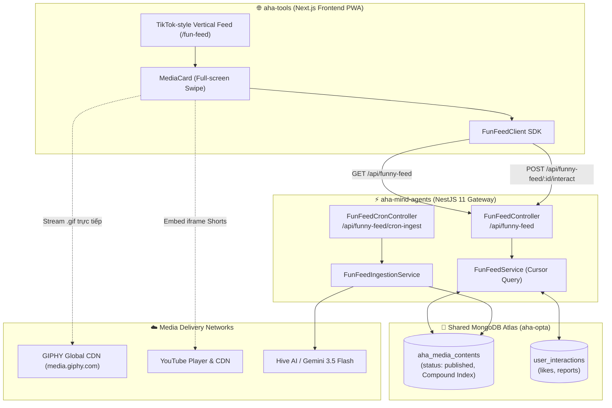

# Fun Feed (Funny English Memes & Reels) — Frontend Integration Contract (aha-tools ⟷ aha-mind-agents)

> **Document Version:** 1.0.0  
> **Status:** Active / Production Ready  
> **Author:** Anh Tú (IT Lecturer & System Architect)  
> **Target Audience:** Frontend Engineers tại `aha-tools` (Next.js PWA) và Backend Engineers tại `aha-mind-agents` (NestJS)  
> **Base URL (Local):** `http://localhost:3001/api`  
> **Base URL (Production Vercel):** `https://aha-mind-agents.vercel.app/api` (hoặc domain custom của bạn)  
> **Swagger UI:** `http://localhost:3001/api/docs`  

---

## 1. Khái Niệm & Kiến Trúc Tổng Quan (Architecture & Concept Anatomy)

### 1.1. Giải Phẫu Khái Niệm (Definition Anatomy)

> **Decoupled Edutainment Feed Architecture (Kiến trúc Bảng tin Học-Giải trí Tách rời)** là mô hình thiết kế chia tách triệt để giữa **Luồng Thu Thập/Kiểm Duyệt Hậu Trường (Background Ingestion & AI Enrichment)** và **Luồng Hiển Thị Client (Pure Presentation Serving)**. 
> Phía Frontend Next.js (`aha-tools`) đóng vai trò là một **TikTok-style UI Player**, chỉ nhận siêu dữ liệu (Metadata JSON ~1-2 KB) từ Backend để render giao diện, còn toàn bộ băng thông truyền phát video/GIF nặng được trút tải trực tiếp qua CDN của GIPHY và YouTube, giúp ứng dụng đạt tốc độ hiển thị tức thì (Instant Playback 60 FPS) mà không tốn chi phí băng thông máy chủ.



---

## 2. Đặc Tả Chi Tiết Các REST API Endpoints

### 2.1. Lấy danh sách Fun Feed (Cursor Pagination cho TikTok Swipe)

- **Method:** `GET`
- **Path:** `/api/funny-feed`
- **Query Parameters:**

| Tham số | Kiểu dữ liệu | Bắt buộc | Mặc định | Mô tả |
|---|---|---|---|---|
| `limit` | `number` | Không | `10` | Số lượng items cần lấy (kẹp từ 1 đến 20). |
| `topic` | `string` | Không | `undefined` | Lọc theo chủ đề: `grammar`, `vocabulary`, `pronunciation`, `idiom`, `conversation`. |
| `level` | `string` | Không | `undefined` | Lọc theo trình độ: `beginner`, `intermediate`, `advanced`. |
| `cursor` | `string` | Không | `undefined` | Giá trị `nextCursor` nhận được từ lần gọi trước (ISO Date string). Dùng cho Infinite Scroll. |

- **Response Header:** `Content-Type: application/json`
- **Response Body (HTTP 200 OK):**
```json
{
  "items": [
    {
      "_id": "670e3f1a2b3c4d5e6f7a8b9c",
      "source": "giphy",
      "sourceId": "1n6H2AaiflqojnojU3",
      "sourceUrl": "https://giphy.com/gifs/alo7english-1n6H2AaiflqojnojU3",
      "type": "gif",
      "title": "English Grammar Teacher Reaction",
      "mediaUrl": "https://media2.giphy.com/media/1n6H2AaiflqojnojU3/giphy.gif",
      "thumbnailUrl": "https://media2.giphy.com/media/1n6H2AaiflqojnojU3/100.gif",
      "attribution": "alo7english",
      "topic": "grammar",
      "level": "beginner",
      "whyFunny": "Biểu cảm bất lực hài hước của giáo viên khi học sinh nhầm lẫn thì hiện tại hoàn thành và quá khứ đơn.",
      "youLearned": "Phân biệt rõ cách dùng thì Past Simple (chấm dứt hoàn toàn) và Present Perfect (còn kết quả ở hiện tại).",
      "learningScore": 0.85,
      "stats": {
        "views": 420,
        "likes": 56,
        "saves": 12,
        "reports": 0
      },
      "status": "published",
      "publishedAt": "2026-10-16T08:30:00.000Z"
    },
    {
      "_id": "670e3f1a2b3c4d5e6f7a8b9d",
      "source": "youtube",
      "sourceId": "QOALbeDSToQ",
      "sourceUrl": "https://www.youtube.com/watch?v=QOALbeDSToQ",
      "type": "short_video",
      "title": "Present or Past - English Grammar Shorts",
      "mediaUrl": "https://www.youtube.com/embed/QOALbeDSToQ",
      "thumbnailUrl": "https://i.ytimg.com/vi/QOALbeDSToQ/hqdefault.jpg",
      "attribution": "LKLogic",
      "topic": "grammar",
      "level": "intermediate",
      "whyFunny": "Tình huống trớ trêu khi dịch máy nghĩa đen của câu nói.",
      "youLearned": "Cấu trúc đảo ngữ nhấn mạnh trong giao tiếp hàng ngày.",
      "learningScore": 0.9,
      "stats": {
        "views": 1250,
        "likes": 180,
        "saves": 45,
        "reports": 0
      },
      "status": "published",
      "publishedAt": "2026-10-16T08:25:00.000Z"
    }
  ],
  "nextCursor": "2026-10-16T08:25:00.000Z",
  "hasMore": true
}
```

---

### 2.2. Ghi nhận tương tác người dùng (Like / Save / Skip / Report)

- **Method:** `POST`
- **Path:** `/api/funny-feed/:id/interact`
- **Headers:**
  - `Content-Type: application/json`
  - `x-user-id` *(Tùy chọn)*: ID của user đang đăng nhập trên `aha-tools`. Nếu khách vãng lai, bỏ trống.
- **Request Body:**
```json
{
  "action": "like",
  "reportReason": "Lý do báo cáo (chỉ gửi khi action là report)"
}
```
*Các hành động hỗ trợ:*
- `"like"`: Tăng tim bài viết.
- `"save"`: Lưu bài viết.
- `"skip"`: Lướt qua (phục vụ phân tích thời gian dừng sau này).
- `"report"`: Báo cáo vi phạm. Nếu bài viết bị $\ge 3$ reports, hệ thống Backend sẽ tự động ẩn bài viết (`hidden`) ngay lập tức.

- **Response Body (HTTP 201 Created):**
```json
{
  "success": true
}
```

---

## 3. TypeScript Interfaces Chuẩn Cho Frontend (`aha-tools`)

Các lập trình viên Frontend có thể copy trực tiếp khối định nghĩa này vào thư mục `src/types/fun-feed.ts` của repo `aha-tools`:

```typescript
export type FunFeedTopic = 'grammar' | 'vocabulary' | 'pronunciation' | 'idiom' | 'conversation';
export type FunFeedLevel = 'beginner' | 'intermediate' | 'advanced';
export type FunFeedMediaType = 'gif' | 'image' | 'video' | 'short_video';
export type FunFeedAction = 'view' | 'like' | 'skip' | 'save' | 'report';

export interface FunFeedItem {
  _id: string;
  source: 'giphy' | 'youtube' | 'generated';
  sourceId: string;
  sourceUrl: string;
  type: FunFeedMediaType;
  title: string;
  mediaUrl: string;
  thumbnailUrl?: string;
  attribution?: string;
  topic?: FunFeedTopic;
  level?: FunFeedLevel;
  whyFunny?: string;
  youLearned?: string;
  explanation?: string;
  learningScore?: number;
  stats: {
    views: number;
    likes: number;
    saves: number;
    reports: number;
  };
  status: 'published' | 'hidden';
  publishedAt: string;
}

export interface FunFeedResponse {
  items: FunFeedItem[];
  nextCursor: string | null;
  hasMore: boolean;
}

export interface FunFeedQuery {
  topic?: FunFeedTopic;
  level?: FunFeedLevel;
  cursor?: string;
  limit?: number;
}

export interface FunFeedInteractPayload {
  action: FunFeedAction;
  reportReason?: string;
}
```

---

## 4. Client SDK Hoàn Chỉnh Cho Frontend Next.js (`aha-tools`)

Tạo file `src/services/fun-feed.client.ts` trên dự án `aha-tools`:

```typescript
import { FunFeedQuery, FunFeedResponse, FunFeedInteractPayload } from '../types/fun-feed';

export class FunFeedClient {
  private baseUrl: string;

  constructor(baseUrl?: string) {
    this.baseUrl = baseUrl || process.env.NEXT_PUBLIC_AGENTS_API_URL || 'http://localhost:3001/api';
  }

  /**
   * Lấy danh sách feed phân trang theo Cursor
   */
  async getFeed(query: FunFeedQuery = {}): Promise<FunFeedResponse> {
    const params = new URLSearchParams();
    if (query.limit) params.set('limit', query.limit.toString());
    if (query.topic) params.set('topic', query.topic);
    if (query.level) params.set('level', query.level);
    if (query.cursor) params.set('cursor', query.cursor);

    const res = await fetch(`${this.baseUrl}/funny-feed?${params.toString()}`, {
      method: 'GET',
      headers: { 'Accept': 'application/json' },
      cache: 'no-store',
    });

    if (!res.ok) {
      throw new Error(`Failed to fetch fun feed: ${res.statusText}`);
    }

    return res.json();
  }

  /**
   * Gửi tương tác Like / Save / Report
   */
  async interact(contentId: string, payload: FunFeedInteractPayload, userId?: string): Promise<{ success: boolean }> {
    const headers: Record<string, string> = {
      'Content-Type': 'application/json',
    };
    if (userId) {
      headers['x-user-id'] = userId;
    }

    const res = await fetch(`${this.baseUrl}/funny-feed/${contentId}/interact`, {
      method: 'POST',
      headers,
      body: JSON.stringify(payload),
    });

    if (!res.ok) {
      throw new Error(`Failed to send interaction: ${res.statusText}`);
    }

    return res.json();
  }
}

export const funFeedClient = new FunFeedClient();
```

---

## 5. Hướng Dẫn Triển Khai Giao Diện TikTok Reel Trên Next.js

Để mang lại cảm giác vuốt dọc mượt mà như TikTok:

1. **CSS Scroll Snap (Dọc 100vh):**
   ```css
   .feed-container {
     height: 100vh;
     overflow-y: scroll;
     scroll-snap-type: y mandatory;
   }
   .feed-card {
     height: 100vh;
     scroll-snap-align: start;
     position: relative;
   }
   ```
2. **Hiển thị Media theo loại (`type`):**
   - **GIF (`type === 'gif'`):** Sử dụng thẻ ``. Trình duyệt sẽ stream trực tiếp từ CDN của GIPHY.
   - **Shorts YouTube (`type === 'short_video'` hoặc `source === 'youtube'`):** Sử dụng thẻ `<iframe>`:
     ```html
     <iframe
       src={`${item.mediaUrl}?autoplay=1&mute=1&loop=1&controls=0`}
       className="w-full h-full border-0 pointer-events-auto"
       allow="accelerometer; autoplay; clipboard-write; encrypted-media; gyroscope; picture-in-picture"
       allowFullScreen
     />
     ```
3. **Overlay thông tin học tập (Learning Card Overlay):**
   - Đặt ở góc dưới màn hình một nửa trong suốt (Glassmorphism).
   - Hiển thị badge: `[topic]` `[level]`.
   - Hiển thị câu giải thích vui: `💡 ${item.whyFunny}`.
   - Hiển thị kiến thức đúc kết: `🎯 ${item.youLearned}`.
   - Cột nút bấm bên phải: Nút Thả tim (Like count), Nút Save, Nút Báo cáo (Report).

---

*Made by Anh Tu - Share to be share*
