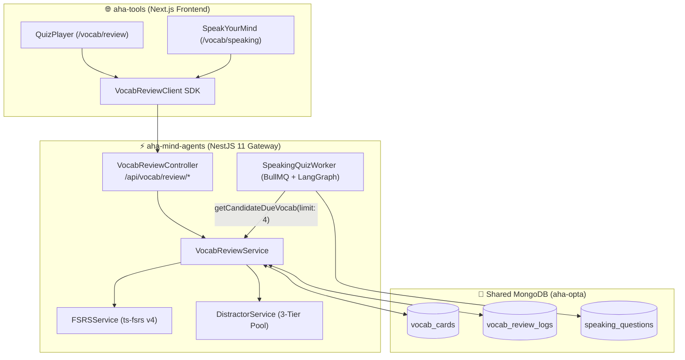

# Vocab Review & SRS Speaking Integration — API Integration Contract (aha-tools ⟷ aha-mind-agents)

> **Document Version:** 1.0.0  
> **Status:** Active / Production Ready  
> **Author:** Anh Tú (IT Lecturer & System Architect)  
> **Target Audience:** Frontend & Backend Engineers tại `aha-tools` (Next.js) và `aha-mind-agents` (NestJS)  
> **Base URL (Local):** `http://localhost:3001/api`  
> **Swagger UI:** `http://localhost:3001/api/docs`  

---

## 1. Khái niệm & Kiến trúc Tổng quan (Architecture & Concept Anatomy)

### 1.1. Giải Phẫu Khái Niệm (Definition Anatomy)

> **Decoupled SRS Presentation Architecture (Kiến trúc Tách rời Giao diện và Động cơ SRS)** là mô hình thiết kế chuyển toàn bộ các phép tính toán chu kỳ ghi nhớ giãn cách (**FSRS Engine**), tổng hợp câu hỏi trắc nghiệm (**Distractor Synthesis**) và ghi vết nhật ký ôn tập (**Review Logging**) sang Backend Microservice độc lập (`aha-mind-agents`). Phía Client Next.js (`aha-tools`) trở thành **Pure Presentation Layer**, chỉ gửi nhận dữ liệu thông qua Client SDK chuẩn hóa, giúp loại bỏ gánh nặng tính toán và tăng tốc độ render giao diện tối đa.



---

## 2. Đặc Tả Chi Tiết Các REST API Endpoints

### 2.1. Endpoint 1: Lấy Danh Sách Câu Hỏi Phiên Ôn Tập

- **Method:** `GET`
- **Path:** `/api/vocab/review/session`
- **Query Parameters:**

| Tham số | Kiểu dữ liệu | Bắt buộc | Mặc định | Mô tả |
|---|---|---|---|---|
| `limit` | `number` | Không | `15` | Số lượng câu hỏi tối đa trong phiên (kẹp từ 1 đến 30). |
| `practiceAll` | `boolean` | Không | `false` | Nếu `true`, ôn tập toàn bộ từ vựng bất kể ngày đến hạn (`due`). |

- **Response (HTTP 200 OK):**
```json
{
  "questions": [
    {
      "cardId": "670a1b2c3d4e5f6a7b8c9d0e",
      "word": "sustainable",
      "ipa": "/səˈsteɪ.nə.bəl/",
      "audioUrl": "https://...",
      "level": "B2",
      "wordFamily": [],
      "collocations": [],
      "sourceStorybookTitle": "The Future of Energy",
      "explanation": "Có thể duy trì lâu dài, bền vững",
      "options": [
        { "id": "A", "text": "Có thể duy trì lâu dài, bền vững", "isCorrect": true },
        { "id": "B", "text": "Phức tạp và khó giải quyết", "isCorrect": false },
        { "id": "C", "text": "Nhanh chóng biến mất", "isCorrect": false },
        { "id": "D", "text": "Tạm thời không xác định", "isCorrect": false }
      ],
      "exampleSentences": [
        { "sentence": "Solar energy is a ___ source of power.", "answer": "sustainable" }
      ],
      "quizMode": "cloze",
      "fsrsState": {
        "due": "2026-10-13T06:00:00.000Z",
        "reps": 3,
        "stability": 2.4
      }
    }
  ],
  "totalDue": 12,
  "sessionLimit": 15,
  "totalSaved": 145
}
```

---

### 2.2. Endpoint 2: Nộp Kết Quả Trắc Nghiệm Ôn Tập

- **Method:** `POST`
- **Path:** `/api/vocab/review/submit`
- **Request Body:**
```json
{
  "cardId": "670a1b2c3d4e5f6a7b8c9d0e",
  "isCorrect": true,
  "responseTimeMs": 3200
}
```

- **Response (HTTP 200 OK):**
```json
{
  "success": true,
  "cardId": "670a1b2c3d4e5f6a7b8c9d0e",
  "word": "sustainable",
  "isCorrect": true,
  "rating": 3,
  "nextDue": "2026-10-18T10:00:00.000Z",
  "stability": 4.8,
  "difficulty": 4.2,
  "reps": 4,
  "lapses": 0
}
```

---

### 2.3. Endpoint 3: Đếm Số Lượng Từ Đến Hạn

- **Method:** `GET`
- **Path:** `/api/vocab/review/due-count`
- **Response (HTTP 200 OK):**
```json
{
  "dueCount": 12,
  "totalCount": 145,
  "newCount": 18,
  "learningCount": 65,
  "masteredCount": 62,
  "nextDueTimestamp": "2026-10-13T15:30:00.000Z"
}
```

---

## 3. TypeScript Client SDK Dành Cho `aha-tools`

Nhóm Frontend `aha-tools` sao chép file này vào:  
👉 `src/lib/services/vocab-review-client.ts`

```typescript
/**
 * @file vocab-review-client.ts
 * @description Client SDK chuẩn hóa kết nối aha-tools với aha-mind-agents Vocab Review API
 *
 * Made by Anh Tu - Share to be share
 */

const AGENTS_GATEWAY_URL =
  process.env.NEXT_PUBLIC_AGENTS_API_URL ||
  process.env.AGENTS_API_URL ||
  'http://localhost:3001/api';

export interface QuizOption {
  id: string;
  text: string;
  isCorrect: boolean;
}

export interface QuizQuestion {
  cardId: string;
  word: string;
  ipa?: string;
  audioUrl?: string;
  level: string;
  wordFamily?: any[];
  collocations?: any[];
  sourceStorybookTitle?: string;
  explanation: string;
  options: QuizOption[];
  exampleSentences?: Array<{ sentence: string; answer: string }>;
  quizMode: 'mcq' | 'cloze';
  fsrsState: {
    due: string;
    reps: number;
    stability: number;
  };
}

export interface ReviewSessionData {
  questions: QuizQuestion[];
  totalDue: number;
  sessionLimit: number;
  totalSaved: number;
}

export interface SubmitReviewPayload {
  cardId: string;
  isCorrect: boolean;
  responseTimeMs: number;
}

export interface SubmitReviewResult {
  success: boolean;
  cardId: string;
  word: string;
  isCorrect: boolean;
  rating: number;
  nextDue: string;
  stability: number;
  difficulty: number;
  reps: number;
  lapses: number;
}

export interface VocabDueCountData {
  dueCount: number;
  totalCount: number;
  newCount: number;
  learningCount: number;
  masteredCount: number;
  nextDueTimestamp?: string;
}

/**
 * Lấy danh sách câu hỏi trắc nghiệm / cloze của phiên ôn tập
 */
export async function fetchReviewSessionQuestions(options: {
  limit?: number;
  practiceAll?: boolean;
} = {}): Promise<ReviewSessionData> {
  const params = new URLSearchParams();
  if (options.limit) params.set('limit', String(options.limit));
  if (options.practiceAll) params.set('practiceAll', 'true');

  const res = await fetch(`${AGENTS_GATEWAY_URL}/vocab/review/session?${params.toString()}`, {
    method: 'GET',
    headers: { 'Content-Type': 'application/json' },
    cache: 'no-store',
  });

  if (!res.ok) {
    throw new Error(`Lỗi lấy phiên ôn tập: HTTP ${res.status}`);
  }

  return res.json();
}

/**
 * Nộp kết quả ôn tập FSRS của một thẻ từ vựng
 */
export async function submitVocabCardReview(
  payload: SubmitReviewPayload,
): Promise<SubmitReviewResult> {
  const res = await fetch(`${AGENTS_GATEWAY_URL}/vocab/review/submit`, {
    method: 'POST',
    headers: { 'Content-Type': 'application/json' },
    body: JSON.stringify(payload),
  });

  if (!res.ok) {
    throw new Error(`Lỗi nộp kết quả review: HTTP ${res.status}`);
  }

  return res.json();
}

/**
 * Lấy số lượng thẻ từ vựng đến hạn và phân loại trạng thái học
 */
export async function fetchVocabDueCount(): Promise<VocabDueCountData> {
  const res = await fetch(`${AGENTS_GATEWAY_URL}/vocab/review/due-count`, {
    method: 'GET',
    headers: { 'Content-Type': 'application/json' },
    next: { revalidate: 60 },
  });

  if (!res.ok) {
    throw new Error(`Lỗi lấy thống kê từ đến hạn: HTTP ${res.status}`);
  }

  return res.json();
}
```

---

## 4. Hướng Dẫn Điều Chỉnh Route Handlers Tại `aha-tools`

### 4.1. `src/app/api/vocab/review/route.ts` (Proxy mỏng gọi sang Gateway)

```typescript
import { NextRequest, NextResponse } from "next/server";
import { submitVocabCardReview } from "@/lib/services/vocab-review-client";

export async function POST(request: NextRequest) {
  try {
    const body = await request.json();
    const result = await submitVocabCardReview(body);
    return NextResponse.json(result);
  } catch (err: any) {
    return NextResponse.json(
      { error: err.message || "Lỗi ghi nhận kết quả ôn tập" },
      { status: 500 }
    );
  }
}
```

### 4.2. `src/app/api/vocab/due-count/route.ts`

```typescript
import { NextResponse } from "next/server";
import { fetchVocabDueCount } from "@/lib/services/vocab-review-client";

export const dynamic = "force-dynamic";

export async function GET() {
  try {
    const data = await fetchVocabDueCount();
    return NextResponse.json(data);
  } catch (err: any) {
    return NextResponse.json(
      { error: err.message || "Lỗi lấy số lượng từ cần ôn" },
      { status: 500 }
    );
  }
}
```

---

## 5. Hướng Dẫn Hiển Thị SRS Badges Trong Giao Diện Speaking Quiz

Trong component `SpeakingPrepCard.tsx` hoặc `SpeakYourMindHub.tsx`, hiển thị badge tương ứng với `srsStatus` của từng từ khóa mục tiêu:

```tsx
interface KeywordBadgeProps {
  word: string;
  srsStatus?: 'due' | 'learning' | 'mastered' | 'new' | 'unsaved';
  isInjected?: boolean;
}

export function KeywordBadge({ word, srsStatus, isInjected }: KeywordBadgeProps) {
  const getBadgeStyle = () => {
    switch (srsStatus) {
      case 'due':
        return 'bg-red-500/10 text-red-400 border-red-500/30';
      case 'learning':
        return 'bg-amber-500/10 text-amber-400 border-amber-500/30';
      case 'mastered':
        return 'bg-emerald-500/10 text-emerald-400 border-emerald-500/30';
      case 'new':
      default:
        return 'bg-slate-500/10 text-slate-300 border-slate-500/30';
    }
  };

  const getLabel = () => {
    switch (srsStatus) {
      case 'due': return 'Cần ôn';
      case 'learning': return 'Đang học';
      case 'mastered': return 'Đã thuộc';
      default: return 'Từ mới';
    }
  };

  return (
    <span className={`inline-flex items-center gap-1.5 px-2.5 py-1 rounded-full text-xs font-medium border ${getBadgeStyle()}`}>
      {isInjected && <span className="w-1.5 h-1.5 rounded-full bg-red-400 animate-pulse" />}
      <span>{word}</span>
      {srsStatus && <span className="opacity-75 text-[10px]">({getLabel()})</span>}
    </span>
  );
}
```

---

*Made by Anh Tu - Share to be share*
