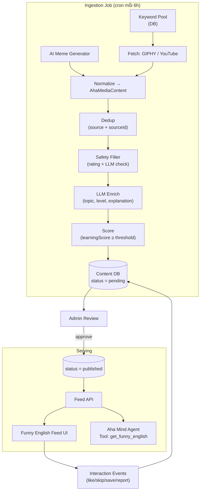

# Spec: Fun Feed – Aha Tools

| Mục | Nội dung |
|---|---|
| Version | 0.1 (MVP) |
| Owner | Tu Vu Anh |
| Stack | LangGraph TypeScript, Gemini / DeepSeek / OpenAI, DB hiện có của Aha |
| Trạng thái | Draft |

---

## 1. Mục tiêu

Xây dựng một feed hiển thị **meme, GIF, image, short video** vui nhộn về tiếng Anh. Mục tiêu chính mang tính giải trí và tăng tương tác người dùng, không tập trung vào việc dạy học.
Fun Feed cho phép người dùng xem, lướt qua các nội dung như tiktok hoặc Reels 

### 1.1 In scope (MVP)
- Feed gồm 3 loại: `gif`, `image`, `video` (YouTube embed).
- UX: thiết kế như Tiktok feed, người dùng vuốt lên để xem nội dung tiếp theo.
- Like / Skip / Save / Report. (Optional - có thể bỏ qua)
- Admin duyệt nội dung trước khi publish. (Optional - có thể bỏ qua)
- Có thể download nội dung về máy

### 1.2 Out of scope (MVP)
- Upload nội dung từ người dùng.
- TikTok, Instagram, Facebook (API hạn chế, rủi ro bản quyền).
- Recommendation cá nhân hoá bằng ML (dùng rule-based trước).
- Mini quiz (để phase 2).

---

## 2. User Stories

| ID | Là… | Tôi muốn… | Để… | Ưu tiên |
|---|---|---|---|---|
| US-01 | Learner | Xem feed meme/video tiếng Anh | Giải trí và học nhẹ nhàng | Must |
| US-02 | Learner | Hỏi Aha Agent "show me something funny about idioms" | Lấy nội dung qua chat | Must |

---

## 3. Nguồn nội dung

| Nguồn | Loại | Cách dùng | Ràng buộc chính |
|---|---|---|---|
| GIPHY API | GIF, sticker, Clips | Search API theo keyword | Beta key giới hạn ~100 calls/giờ → cần production key khi go-live |
| YouTube Data API v3 | Video, Shorts | `search.list` + `videos.list`, hiển thị bằng embed | Quota theo ngày; `search.list` tốn nhiều unit → phải cache |
| AI-generated | Meme image | LLM viết caption + image model sinh ảnh | Cần review chất lượng chữ trên ảnh |
| (Phase 2) Pexels / Pixabay | Image, video | Ảnh nền để ghép meme | – |

**Không dùng:** Tenor (không nhận API client mới từ 01/2026), scrape mạng xã hội.

> ⚠️ Kiểm tra lại quota và Terms of Service của từng API trước khi go-live (attribution, giới hạn cache, hiển thị logo nguồn).

---

## 4. Kiến trúc



**Quyết định chính:**
1. **Pre-fetch + cache**, không gọi API ngoài lúc user mở feed → tiết kiệm quota, phản hồi nhanh.
2. **LLM chỉ chạy ở ingestion**, không chạy lúc serving → chi phí cố định, dễ kiểm soát.
3. **LLM provider dùng lại lớp abstraction** đã có trong Aha (Gemini / DeepSeek / OpenAI).

## 6. Data Model

```ts
type MediaType = "gif" | "image" | "video" | "short_video";
type Source = "giphy" | "youtube" | "generated";

interface AhaMediaContent {
  id: string;
  source: Source;
  sourceId: string;            // id gốc (GIPHY id, YouTube videoId)
  sourceUrl: string;           // link gốc – bắt buộc để attribution
  type: MediaType;
  title: string;
  mediaUrl: string;            // GIF/image URL hoặc YouTube embed URL
  thumbnailUrl?: string;
  attribution?: string;        // tên channel / creator

  stats: { views: number; likes: number; saves: number; reports: number };
  createdAt: Date;
  publishedAt?: Date;
}

interface KeywordPool {
  id: string;
  keyword: string;             // "english grammar meme"
  topic: Topic;
  source: Source | "all";
  enabled: boolean;
  lastFetchedAt?: Date;
}

interface UserInteraction {
  userId: string;
  contentId: string;
  action: "view" | "like" | "skip" | "save" | "report";
  reportReason?: string;
  createdAt: Date;
}
```

**Index:** `(status, learning.topic, learning.level, publishedAt)`, unique `(source, sourceId)`.

---

## 7. API

| Method | Endpoint | Mô tả |
|---|---|---|
| GET | `/api/funny-feed?topic=&level=&type=&cursor=&limit=10` | Lấy feed (cursor pagination) |
| GET | `/api/funny-feed/:id` | Chi tiết item |
| POST | `/api/funny-feed/:id/interact` | `{ action, reportReason? }` |
| GET | `/api/funny-feed/saved` | Danh sách đã save |
| GET | `/api/admin/funny-feed?status=pending` | Hàng chờ duyệt |
| PATCH | `/api/admin/funny-feed/:id` | `{ status }` approve / reject / hide |
| CRUD | `/api/admin/keywords` | Quản lý keyword pool |

### Agent Tool

```ts
const getFunnyEnglish = tool({
  name: "get_funny_english",
  description: "Get published funny English memes/videos for the learner.",
  schema: z.object({
    topic: z.enum(["grammar","vocabulary","pronunciation","idiom","conversation"]).optional(),
    level: z.enum(["beginner","intermediate","advanced"]).optional(),
    type:  z.enum(["gif","image","video","short_video"]).optional(),
    limit: z.number().max(5).default(3),
  }),
  // Chỉ đọc từ DB (status = published), KHÔNG gọi API ngoài
});
```


## 10. Non-functional Requirements

| Hạng mục | Yêu cầu |
|---|---|
| Hiệu năng | Feed API p95 < 300 ms (đọc từ DB/cache) |
| Quota | Ingestion không vượt 70% quota ngày của mỗi API; có circuit breaker |
| An toàn | Chỉ nội dung rating G; 100% item qua admin review ở MVP |
| Bản quyền | Không tải lại video; luôn hiện nguồn + link gốc; tuân thủ ToS từng API |
| Chi phí LLM | Chỉ gọi khi ingestion; ước tính 1–2 call/item |
| Observability | Log số item fetched / rejected / published mỗi job |
| Lỗi nguồn | Một nguồn lỗi không làm hỏng cả job (fail độc lập) |

---

## 11. Rủi ro & Giảm thiểu

| Rủi ro | Mức | Giảm thiểu |
|---|---|---|
| Nội dung không phù hợp (thô tục, xúc phạm) | Cao | Rating G + LLM safety check + admin review + report |
| LLM giải thích sai | Trung bình | Admin review; JSON schema chặt; giới hạn độ dài |
| Hết quota API | Trung bình | Cache, cron thưa, ưu tiên keyword thiếu nội dung |
| Video YouTube bị xoá / private | Thấp | Job kiểm tra định kỳ, tự `hidden` |
| Đổi chính sách API (như Tenor) | Thấp | Adapter pattern cho từng nguồn, dễ thay thế |

---

## 12. Kế hoạch triển khai

| Phase | Thời gian | Deliverable |
|---|---|---|
| **P0 – Setup** | Tuần 1 | Đăng ký API key (GIPHY, YouTube), schema DB, keyword pool ban đầu (~30 keyword) |
| **P1 – Ingestion** | Tuần 2–3 | LangGraph pipeline, adapter GIPHY + YouTube, enrich + score |
| **P2 – Admin** | Tuần 3 | Màn duyệt nội dung, quản lý keyword |
| **P3 – Feed** | Tuần 4 | Feed API + UI card + interaction |
| **P4 – Agent** | Tuần 5 | Tool `get_funny_english` cho Aha Mind Agent |
| **Pilot** | Tuần 6 | Chạy thử với nhóm learner nhỏ, thu feedback |
| **Phase 2** | Sau pilot | AI-generated meme, mini quiz, Pexels/Pixabay, cá nhân hoá |

---

## 13. Acceptance Criteria (MVP)

- [ ] Ingestion job chạy tự động, mỗi lần tạo ≥ 20 item `pending`.
- [ ] ≥ 200 item `published`, phủ đủ 5 topic và 3 level.
- [ ] 100% item published có `whyFunny`, `youLearned`, `sourceUrl`.
- [ ] Lọc topic/level trả kết quả đúng.
- [ ] Item có ≥ 3 report tự ẩn.
- [ ] Agent trả về item khi user hỏi "show me something funny about idioms".
- [ ] Không gọi API ngoài trong luồng serving.

## 14. Success Metrics (sau pilot)

| Metric | Mục tiêu |
|---|---|
| Like rate (likes / views) | ≥ 15% |
| Save rate | ≥ 5% |
| Report rate | < 1% |
| Thời gian xem feed / phiên | ≥ 3 phút |
| Learner nhớ được ≥ 1 từ mới (survey) | ≥ 60% |
