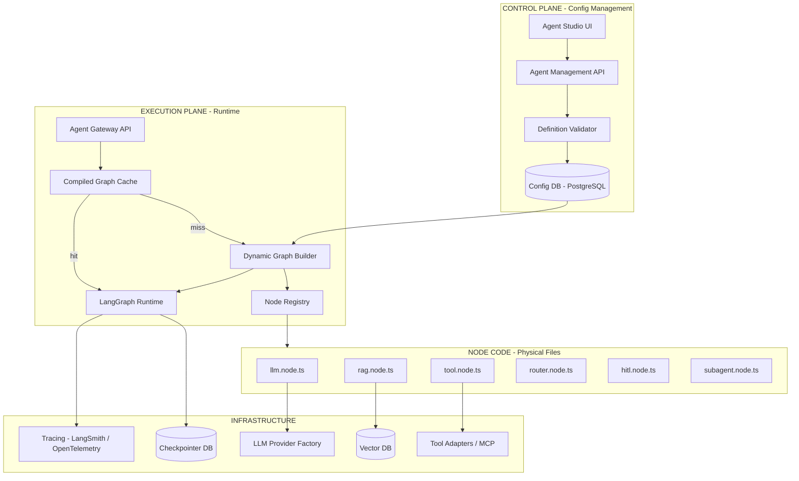
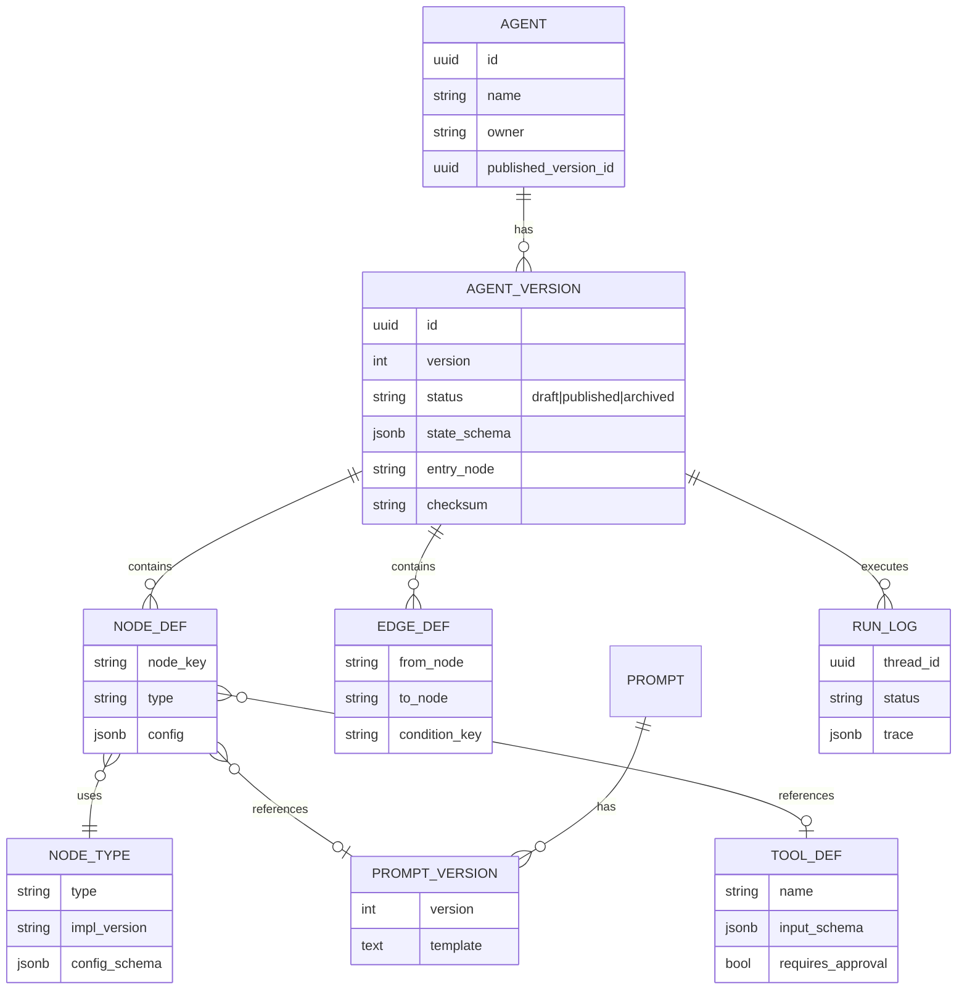
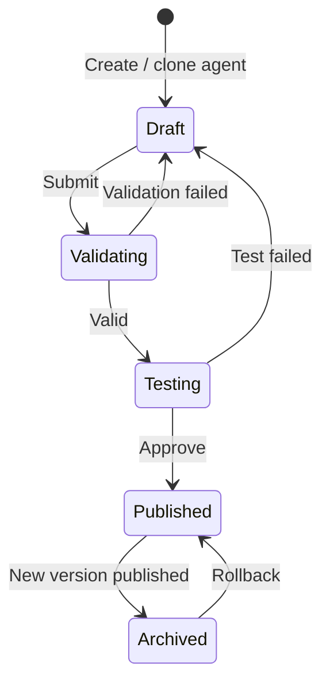
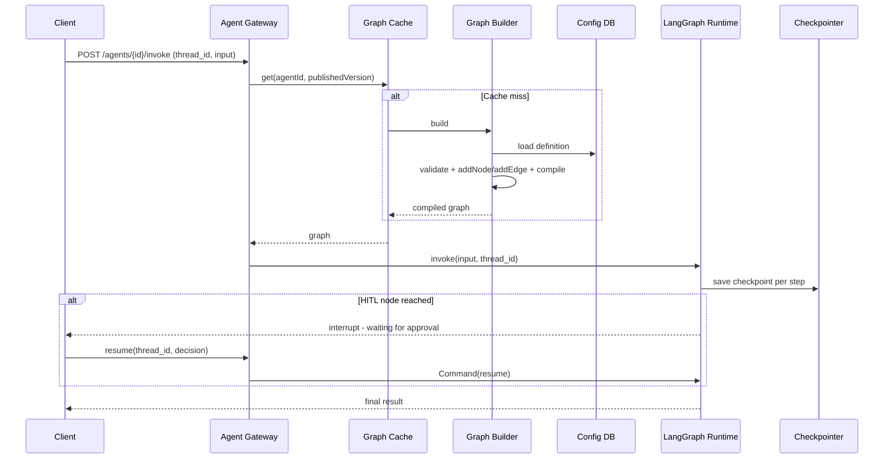
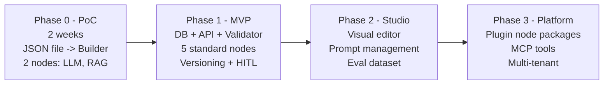

# Solution: DB-Configured Agent System on LangGraph

**Verdict:** Feasible, if we split the system into two parts:

- **Agent structure** (nodes, edges, prompts, models, tools) → stored in the **DB**
- **Node logic** → stays as **code in the repo**, loaded via a **Node Registry**

Do not store or run custom code from the DB.

---

## 1. Goal and Scope

| Area             | MVP                                           | Later                           |
| ---------------- | --------------------------------------------- | ------------------------------- |
| Agent management | Create, edit, delete, clone agents            | Agent marketplace               |
| Graph            | Nodes, edges, conditional edges, START/END    | Complex loops, parallel fan-out |
| Node types       | LLM, RAG, Tool, Router, HITL, SubAgent        | User-written custom code        |
| LLM              | Gemini, OpenAI, DeepSeek via Provider Factory | Custom fine-tuned models        |
| Operations       | Versioning, publish, rollback, tracing        | Full drag-and-drop editor       |

**Key question:** Can we change agent behavior (flow, prompt, model, tool) **without redeploying the backend**?

---

## 2. Architecture



**Design rules:**

1. **DB stores the "WHAT":** which nodes, how they connect, and each node's config.
2. **Code defines the "HOW":** how each node type processes state.
3. **The Registry is the contract:** each `node.type` maps to one registered implementation and its config schema.

---

## 3. Data Model



**Key point:** `NODE_TYPE.config_schema` (JSON Schema or Zod) is **generated from code** at startup and synced to the DB. The UI then knows which nodes are valid and which fields they need.

---

## 4. Core Components

### 4.1 Node Registry

```typescript
import { z } from "zod";

export interface NodeDefinition<C> {
  type: string;
  version: string;
  configSchema: z.ZodType<C>;
  create: (config: C, deps: RuntimeDeps) =>
    (state: AgentState) => Promise<Partial<AgentState>>;
}

export const llmNodeDef: NodeDefinition<LlmConfig> = {
  type: "llm",
  version: "1.0.0",
  configSchema: z.object({
    provider: z.enum(["gemini", "openai", "deepseek"]),
    model: z.string(),
    promptId: z.string(),
    temperature: z.number().min(0).max(2).default(0.3),
  }),
  create: (config, deps) => async (state) => {
    const model = deps.llmFactory.get(config.provider, config.model);
    const prompt = await deps.prompts.render(config.promptId, state);
    const res = await model.invoke(prompt);
    return { messages: [res] };
  },
};

export const registry = new Map(
  [llmNodeDef, ragNodeDef, toolNodeDef, routerNodeDef, hitlNodeDef]
    .map(d => [d.type, d])
);
```

### 4.2 Dynamic Graph Builder

```typescript
export async function buildGraph(def: AgentVersion, deps: RuntimeDeps) {
  const graph = new StateGraph(AgentStateAnnotation);

  for (const n of def.nodes) {
    const impl = registry.get(n.type);
    if (!impl) throw new Error(`Unknown node type: ${n.type}`);
    const config = impl.configSchema.parse(n.config); // validate at build time
    graph.addNode(n.key, impl.create(config, deps));
  }

  for (const e of def.edges) {
    if (e.conditionKey) {
      graph.addConditionalEdges(e.from, routers[e.conditionKey], e.mapping);
    } else {
      graph.addEdge(e.from, e.to);
    }
  }

  graph.addEdge(START, def.entryNode);
  return graph.compile({ checkpointer: deps.checkpointer });
}
```

### 4.3 Compiled Graph Cache

- Cache key: `agentId + versionId + checksum`.
- Clear the cache when a new version is published (use Redis pub/sub for multiple instances).
- Avoids rebuilding the graph on every request.

### 4.4 Definition Validator (runs before publish)

- Every `node.type` exists in the registry.
- Every `config` matches its schema.
- The graph is connected: it has an entry node, every node can reach END, and no node is orphaned.
- Every conditional edge points to a registered router.
- Tools with `requires_approval = true` must pass through a HITL node.

---

## 5. Flows

### 5.1 Config Lifecycle



### 5.2 Runtime Flow



> ⚠️ **Version pinning:** If a thread is paused at HITL and a new version is published, the thread **must resume on its original version**. Store `version_id` per `thread_id`.

---

## 6. Feasibility Assessment

### 6.1 Technical Feasibility

| Criterion                                     | Level          | Reason                                                                                  |
| --------------------------------------------- | -------------- | --------------------------------------------------------------------------------------- |
| Build graphs dynamically in LangGraph         | 🟢 High        | `addNode`/`addEdge` are runtime APIs and can run in a loop                          |
| Switch model/provider via config              | 🟢 High        | Provider Factory with a shared interface                                                |
| Change prompts without redeploy               | 🟢 High        | Prompts are versioned in the DB                                                         |
| Change flow (edges) without redeploy          | 🟢 High        | Graph is rebuilt from the definition                                                    |
| Conditional routing from DB                   | 🟡 Medium      | Router functions are still code; DB only selects the router and mapping                 |
| Dynamic state schema                          | 🟡 Medium–Low | Keep one standard state schema; allow extension via`context: Record<string, unknown>` |
| Add a**new node type** without redeploy | 🔴 Low         | Needs plugins or a sandbox; defer to a later phase                                      |
| HITL resume across version changes            | 🟡 Medium      | Solved with version pinning                                                             |

### 6.2 MVP Effort Estimate (1 BE + 1 FE)

| Work Item                                             | Effort                                        |
| ----------------------------------------------------- | --------------------------------------------- |
| Data model + Management API + Validator               | 1.5 weeks                                     |
| Node Registry + 5 standard nodes + Provider Factory   | 2 weeks                                       |
| Graph Builder + Cache + Checkpointer                  | 1 week                                        |
| HITL + version pinning                                | 1 week                                        |
| Admin UI (form + JSON editor + Mermaid graph preview) | 2 weeks                                       |
| Tracing, testing, hardening                           | 1.5 weeks                                     |
| **Total**                                       | **≈ 9 weeks** (reduced PoC ≈ 2 weeks) |

*These are rough estimates. Adjust them to the team's actual capacity.*

### 6.3 Risks and Mitigation

| Risk                                              | Impact | Mitigation                                                                        |
| ------------------------------------------------- | ------ | --------------------------------------------------------------------------------- |
| Bad config breaks agents in production            | High   | Validator, test environment, versioned publish, 1-click rollback                  |
| Node code and config drift apart (schema changes) | High   | `impl_version` per node type, config migration, compatibility check at startup  |
| HITL threads stuck after version change           | Medium | Pin version per thread                                                            |
| Slow graph builds                                 | Low    | Compiled graph cache                                                              |
| Users want custom logic                           | Medium | Provide generic nodes (Transform via JSONata, HTTP Tool, MCP Tool); avoid`eval` |
| Prompt injection / tool misuse                    | High   | Per-agent tool whitelist, mandatory HITL for external actions, audit log          |
| Hard to debug dynamic graphs                      | Medium | Trace by node_key + version; render Mermaid from the definition                   |

---

## 7. Roadmap



### PoC Go/No-Go Criteria

| # | Criterion                    | Pass when                                                              |
| - | ---------------------------- | ---------------------------------------------------------------------- |
| 1 | Change flow without redeploy | Edit an edge in JSON → next call runs the new flow                    |
| 2 | Switch provider              | Change`gemini` to `deepseek` in config → valid output             |
| 3 | Validator blocks errors      | Wrong type or broken graph is rejected before runtime                  |
| 4 | HITL                         | Interrupts and resumes on the right thread and version                 |
| 5 | Performance                  | Graph build < 50 ms; near 0 ms on cache hit (target, must be measured) |

---

## 8. Recommendations

1. **Use "Config in DB + Code in Registry".** It best balances flexibility and safety.
2. **Standardize the state schema early.** It is the hardest part to change later.
3. **Build the Validator and Versioning first**, before the drag-and-drop UI.
4. **No code-in-DB / `eval`.** To extend, use reviewed and deployed plugin packages.
5. **Start with a 2-week PoC on Aha Mind Agent:** move the current graph to a JSON definition and check the 5 Go/No-Go criteria above.
