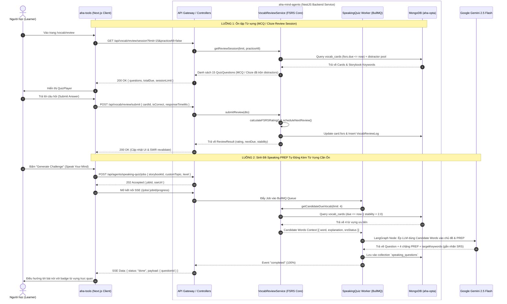

# Design Specification: Di chuyển Logic Vocab Review sang `aha-mind-agents` & Tích hợp Từ vựng vào Speaking Quiz

> **Document Version:** 1.0.0  
> **Status:** Approved / In Planning  
> **Author:** Anh Tú (IT Lecturer & System Architect)  
> **Target Systems:** `aha-mind-agents` (NestJS 11 Microservice) ⟷ `aha-tools` (Next.js 16 Client)  
> **Created Date:** 2026-10-13  

---

## 1. Khái niệm & Giải phẫu Thuật ngữ (Definition Anatomy)

> **Decoupled SRS-Speaking Closed-Loop Architecture (Kiến trúc Vòng lặp Khép kín Tách rời giữa SRS và Speaking)** là mô hình thiết kế phần mềm hợp nhất, trong đó toàn bộ nghiệp vụ quản lý trạng thái ghi nhớ giãn cách (**FSRS Engine**), thuật toán sinh câu hỏi trắc nghiệm (**Distractor Generation**) và điều phối AI (**Multi-Agent Orchestration**) được tập trung hóa tại dịch vụ tính toán nền tảng (**Backend Microservice** - `aha-mind-agents`). Tại đây, các từ vựng đang ở chu kỳ suy giảm trí nhớ (**Memory Decay / Due Cards**) được tự động trích xuất trực tiếp từ cơ sở dữ liệu để làm tiền đề ngữ cảnh (**Contextual Constraint**) cho tác vụ sinh đề nói phản biện (**PREP Speaking Challenge**), giúp chuyển hóa kiến thức từ nhận thức thụ động (*Passive Vocabulary*) sang sử dụng chủ động (*Active Vocabulary*).

### Giải phẫu các thành phần cốt lõi (Keyword Anatomy):
1. **FSRS (Free Spaced Repetition Scheduler):** Thuật toán tính toán chu kỳ ghi nhớ thế hệ mới dựa trên độ ổn định trí nhớ (*Stability - S*) và độ khó (*Difficulty - D*), thay thế mô hình SM-2 truyền thống.
2. **Distractor Synthesis (Sinh đáp án gây nhiễu):** Cơ chế kết hợp 3 tầng (Personal Cards $\to$ Global Storybook Keywords $\to$ Fallback CEFR Bank) để tạo ra các lựa chọn sai có tính thuyết phục cho câu hỏi MCQ.
3. **Contextual Constraint Injection (Tiêm ràng buộc ngữ cảnh):** Kỹ thuật Prompt Engineering ép mô hình LLM phải lồng ghép chính xác các từ vựng mục tiêu vào đề tài tranh luận và các chặng của giàn giáo PREP mà không làm mất đi tính tự nhiên của câu hỏi.
4. **Pure Presentation Layer (Tầng hiển thị thuần túy):** Vai trò mới của Next.js (`aha-tools`), loại bỏ hoàn toàn các tác vụ tính toán và lưu vết FSRS, chỉ tiêu thụ API qua Client SDK chuẩn hóa.

---

## 2. Bối Cảnh & Phân Tích Nguyên Nhân (Root Cause Analysis & Architectural Drivers)

### 2.1. Vấn đề của Kiến trúc Hiện tại
1. **Phân mảnh Logic Nghiệp vụ (Fragmented Domain Logic):** Logic FSRS và sinh bài tập review đang nằm trong Serverless Route Handlers của `aha-tools` (`src/app/api/vocab/review/route.ts`, `review-session.service.ts`). Khi các ứng dụng khác hoặc các Agent khác cần tương tác với từ vựng, chúng không thể tái sử dụng.
2. **Sự Tách Biệt Giữa Học Từ Vựng và Luyện Nói (Siloed Learning Experience):**
   - Học viên học từ mới qua Storybook $\to$ Ôn tập thụ động qua MCQ/Cloze.
   - Khi chuyển sang **Speak Your Mind (Speaking Quiz)**, AI lại sinh ra các từ vựng hoàn toàn ngẫu nhiên, không liên kết với kho từ mà học viên đang cần củng cố trí nhớ.
3. **Anti-pattern "Frontend-Driven Backend Dependency":** Việc định hình luồng dữ liệu bắt Frontend Next.js query DB rồi gửi payload từ vựng lên cho AI Backend tạo ra gánh nặng mạng, tăng độ trễ và làm lộ ranh giới dữ liệu không cần thiết trong khi cả hai hệ thống dùng chung MongoDB.

### 2.2. Mục Tiêu (Goals & Non-Goals)
- **Goals:**
  - Di chuyển 100% logic Vocab Review (FSRS Engine, Distractor Generation, Session Synthesis, Review Log) sang `aha-mind-agents` dưới dạng module `VocabReviewModule`.
  - Cung cấp REST API chuẩn hóa từ `aha-mind-agents` cho `aha-tools` tiêu thụ: lấy phiên câu hỏi, nộp kết quả review, lấy số lượng từ đến hạn (`due-count`).
  - Trong `SpeakingQuizWorker` của `aha-mind-agents`, tự động trích xuất các từ vựng đang đến hạn (`due <= now`) hoặc đang học (`stability < 2.0`) từ collection `vocab_cards` để tiêm vào prompt sinh đề nói PREP.
  - Hiển thị nhãn trạng thái trực quan (SRS Badge: Due / Learning / Mastered / New) trên từng `targetKeyword` trong giao diện Speaking Quiz.
- **Non-Goals:**
  - Không thay đổi thuật toán FSRS toán học cốt lõi (giữ nguyên công thức và trọng số FSRS hiện hành).
  - Không thay đổi cấu trúc bảng CSDL `vocab_cards` hiện tại trong MongoDB để đảm bảo tương thích ngược 100%.

---

## 3. Kiến Trúc Tổng Thể & Luồng Dữ Liệu (System Architecture)



---

## 4. Chi Tiết Thiết Kế Module Tại `aha-mind-agents`

### 4.1. Cấu Trúc Thư Mục Plugin `vocab-review`
```
aha-mind-agents/src/plugins/vocab-review/
├── vocab-review.module.ts
├── vocab-review.controller.ts
├── services/
│   ├── fsrs.service.ts              # Thuật toán FSRS v4 độc lập
│   ├── distractor.service.ts        # Thuật toán tổng hợp đáp án nhiễu 3 tầng
│   └── vocab-review.service.ts      # Nghiệp vụ phiên ôn tập & submit review
├── dto/
│   ├── review-session-query.dto.ts
│   ├── submit-review.dto.ts
│   └── candidate-vocab.dto.ts
└── schemas/
    ├── vocab-card.schema.ts         # Mapping collection `vocab_cards`
    └── vocab-review-log.schema.ts   # Mapping collection `vocab_review_logs`
```

### 4.2. Đặc tả API Endpoints Của `VocabReviewController`

#### Endpoint 1: Lấy danh sách câu hỏi phiên ôn tập
- **Method:** `GET`
- **Path:** `/api/vocab/review/session`
- **Query Params:**
  - `limit` (number, optional, default: 15, max: 30)
  - `practiceAll` (boolean, optional, default: false)
- **Response (200 OK):**
```json
{
  "questions": [
    {
      "cardId": "670a1b2c3d4e5f6a7b8c9d0e",
      "word": "sustainable",
      "ipa": "/səˈsteɪ.nə.bəl/",
      "audioUrl": "https://...",
      "level": "B2",
      "explanation": "Có thể duy trì lâu dài, bền vững",
      "options": [
        { "id": "A", "text": "Có thể duy trì lâu dài, bền vững", "isCorrect": true },
        { "id": "B", "text": "Phức tạp và khó giải quyết", "isCorrect": false },
        { "id": "C", "text": "Nhanh chóng biến mất", "isCorrect": false },
        { "id": "D", "text": "Tạm thời không xác định", "isCorrect": false }
      ],
      "exampleSentences": [
        { "sentence": "Solar energy is a ___ source of power.", "answer": "sustainable" }
      ],
      "quizMode": "cloze",
      "fsrsState": {
        "due": "2026-10-13T06:00:00.000Z",
        "reps": 3,
        "stability": 2.4
      }
    }
  ],
  "totalDue": 12,
  "sessionLimit": 15,
  "totalSaved": 145
}
```

#### Endpoint 2: Nộp kết quả câu hỏi ôn tập
- **Method:** `POST`
- **Path:** `/api/vocab/review/submit`
- **Request Body:**
```json
{
  "cardId": "670a1b2c3d4e5f6a7b8c9d0e",
  "isCorrect": true,
  "responseTimeMs": 3200
}
```
- **Response (200 OK):**
```json
{
  "success": true,
  "cardId": "670a1b2c3d4e5f6a7b8c9d0e",
  "word": "sustainable",
  "isCorrect": true,
  "rating": 3,
  "nextDue": "2026-10-18T10:00:00.000Z",
  "stability": 4.8,
  "difficulty": 4.2,
  "reps": 4,
  "lapses": 0
}
```

#### Endpoint 3: Đếm số lượng từ đến hạn
- **Method:** `GET`
- **Path:** `/api/vocab/review/due-count`
- **Response (200 OK):**
```json
{
  "dueCount": 12,
  "totalSaved": 145,
  "nextDueTimestamp": "2026-10-13T15:30:00.000Z"
}
```

---

### 4.3. Tích hợp Nội bộ: Trích xuất Từ vựng vào Speaking Quiz Pipeline

Trong `speaking-quiz.worker.ts` tại `aha-mind-agents`:

1. **Service Injection:** Worker tiêm `VocabReviewService` qua Dependency Injection.
2. **Step `context_resolved`:**
   - Worker gọi hàm: `await this.vocabReviewService.getCandidateDueVocab({ limit: 4 })`
   - Thu được danh sách các từ vựng ưu tiên:
     ```typescript
     interface CandidateVocabItem {
       word: string;
       explanation: string;
       level: string;
       srsStatus: "due" | "learning" | "mastered";
     }
     ```
3. **LangGraph System Prompt Enhancement:**
   Bổ sung chỉ dẫn ràng buộc rõ ràng vào prompt của mô hình ngôn ngữ:
   ```text
   [TARGET VOCABULARY INTEGRATION CONSTRAINT]
   You are provided with a list of active vocabulary cards that the learner is currently reviewing:
   ${candidateVocabList}

   MANDATORY REQUIREMENTS:
   1. You MUST integrate at least 2 to 3 of these candidate words directly into the debate question, context dilemma, or the 4-stage PREP model answers.
   2. For each selected word in "targetKeywords", include the metadata field "srsStatus" matching its input status and set "isInjected: true".
   3. If a word cannot naturally fit into the main debate question title, integrate it smoothly into the "Reason" or "Example" stage of the PREP scaffold.
   ```
4. **Data Schema Update (`speaking-question.schema.ts`):**
   ```typescript
   export class TargetKeywordItem {
     @Prop({ required: true })
     word: string;

     @Prop()
     ipa?: string;

     @Prop({ required: true })
     meaning: string;

     @Prop({ required: false, enum: ['due', 'learning', 'mastered', 'new', 'unsaved'] })
     srsStatus?: string;

     @Prop({ required: false, default: false })
     isInjected?: boolean;
   }
   ```

---

## 5. Chi Tiết Cải Tiến Phía Frontend (`aha-tools`)

### 5.1. Khởi Tạo Client SDK: `src/lib/services/vocab-review-client.ts`
Chuyển đổi toàn bộ lệnh fetch nội bộ sang Agent Backend Gateway:
- `fetchReviewSessionQuestions(options)`
- `submitVocabCardReview(payload)`
- `fetchVocabDueCount()`

### 5.2. Chuyển Đổi Route Handlers & Components
- `src/app/api/vocab/review/route.ts`: Chuyển thành proxy gọn nhẹ gọi sang `aha-mind-agents` hoặc điều hướng trực tiếp bằng Client SDK.
- `src/app/api/vocab/due-count/route.ts`: Kết nối trực tiếp tới Agent Backend.
- `src/components/vocab/review/QuizPlayer.tsx`: Không thay đổi giao diện, chỉ cập nhật endpoint submit review qua client SDK.
- `src/components/vocab/speaking/SpeakingPrepCard.tsx` & `SpeakYourMindHub.tsx`:
  - Thêm hiển thị Badge trạng thái từ vựng:
    - 🔴 **Due (Cần ôn):** Viền đỏ nhẹ / Cam, icon chấm tròn báo động.
    - 🟡 **Learning (Đang học):** Viền vàng hổ phách đặc trưng.
    - 🟢 **Mastered (Đã thuộc):** Viền xanh ngọc bích.
    - ⚪ **New / General:** Viền xám trung tính mặc định.

---

## 6. Đánh Giá Trade-off & Rủi Ro Kỹ Thuật (Trade-off & Risk Analysis)

| Rủi ro / Thách thức | Mức độ | Biện pháp Giảm thiểu (Mitigation Strategy) |
|---|---|---|
| **Độ trễ mạng khi submit từng câu quiz** | Thấp | Request submit review diễn ra bất đồng bộ ngầm (`background optimism`). Giao diện `QuizPlayer` kích hoạt âm thanh và chuyển câu hỏi ngay lập tức mà không chặn người dùng chờ mạng. |
| **Trường hợp kho từ vựng chưa có từ nào đến hạn (`dueCards = 0`)** | Trung bình | `getCandidateDueVocab()` có cơ chế Fallback tự động: nếu không có từ `due <= now`, hệ thống sẽ lấy các từ mới lưu gần nhất (`reps == 0`) hoặc từ có `stability` thấp nhất để đảm bảo luôn có từ để luyện nói. |
| **LLM gượng ép khi ghép từ không cùng ngữ cảnh** | Trung bình | Prompt phân cấp rõ ràng: Ưu tiên đưa từ vào luận điểm chính (Point), nếu không tự nhiên thì đưa vào luận cứ (Reason) hoặc dẫn chứng thực tế (Example). |

---

## 7. Tiêu Chí Nghiệm Thu (Acceptance Criteria - AC)

- [ ] **AC-VOCAB-MIG-01:** Module `VocabReviewModule` chạy thành công trên NestJS của `aha-mind-agents`, vượt qua toàn bộ unit test tính toán FSRS.
- [ ] **AC-VOCAB-MIG-02:** Endpoint `GET /api/vocab/review/session` trả về đủ câu hỏi MCQ và Cloze kèm đáp án nhiễu chính xác 100% so với kết quả trước đây của Next.js.
- [ ] **AC-VOCAB-MIG-03:** Endpoint `POST /api/vocab/review/submit` cập nhật chính xác `fsrs` state trong collection `vocab_cards` và tạo bản ghi trong `vocab_review_logs`.
- [ ] **AC-VOCAB-MIG-04:** Khi tạo một Speaking Quiz mới, Worker tự động trích xuất các từ đang đến hạn ôn và LLM sinh ra câu hỏi có lồng ghép ít nhất 2 từ này với `srsStatus: "due"`.
- [ ] **AC-VOCAB-MIG-05:** Giao diện `SpeakYourMind` hiển thị các badge trạng thái học tập tương ứng cho từng từ vựng mục tiêu.

---

*Made by Anh Tu - Share to be share*
