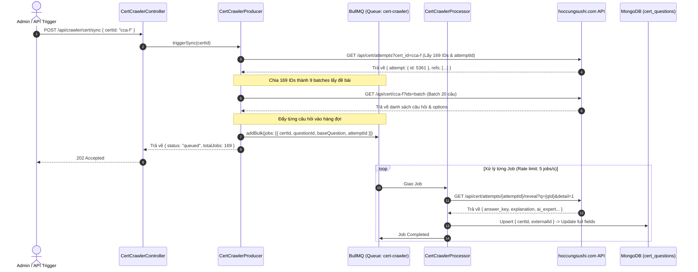

# Universal Cert Question Crawler Agent Architectural Design

> **Tài liệu đặc tả kiến trúc:** Hệ thống Agent thu thập, chuẩn hóa và lưu trữ ngân hàng câu hỏi chứng chỉ (CCAF, CCAO-F và mở rộng) dựa trên kiến trúc hàng đợi phân tán BullMQ và MongoDB trong `aha-mind-agents`.
> **Tác giả:** Anh Tú
> **Thời gian:** 2026-11-02
> **Trạng thái:** Chờ phê duyệt (Pending Approval)

---

## 1. Bối cảnh & Phân tích Nguyên nhân Gốc rễ (Root Cause Analysis)

### 1.1. Hiện trạng & Nhu cầu
Hệ thống `aha-mind-agents` cần sở hữu cơ sở tri thức (Knowledge Base) chuẩn hóa về các chứng chỉ công nghệ hàng đầu (khởi đầu là hệ thống chứng chỉ Claude của Anthropic: **CCAF - Claude Certified Architect Foundations** và **CCAO-F - Claude Certified Associate Foundations**). 

Nguồn dữ liệu mục tiêu được khai thác từ nền tảng `hoccungsushi.com` thông qua hệ thống REST endpoints có xác thực:
* `cca-f`: 169 câu hỏi kiến trúc agent, MCP, tool use, prompt engineering.
* `ccao-f`: 736 câu hỏi vận hành, mô hình Haiku/Sonnet/Opus, connectors, troubleshooting.

### 1.2. Các phát hiện kỹ thuật thực nghiệm (Empirical Findings)
Qua thử nghiệm trực tiếp trên hệ thống nguồn với Cookie xác thực (`HOCCUNGSUSHI_COOKIE`):
1. **Dải ID không liên tục (Non-sequential IDs):** Các câu hỏi không tăng tuần tự `+1`. Ví dụ ở `cca-f`: ID chạy từ 1142 đến 1218 (77 câu), sau đó nhảy sang dải 2801... tới 12511. Nếu duyệt số học thông thường, hệ thống sẽ bỏ sót hơn một nửa số câu.
   * *Giải pháp*: Truy vấn API `/api/cert/attempts?cert_id={certId}` để trích xuất mảng `attempt.question_ids` làm danh sách ID gốc chính xác 100%.
2. **Phân tách 2 tầng dữ liệu (Two-tier Data Architecture):**
   * *Tầng Đề thi (`/api/cert/{certId}?ids=...`)*: Giới hạn tối đa **20 câu / request**. Chỉ chứa nội dung đề bài và lựa chọn A, B, C, D (EN, VI, JA), **không chứa đáp án đúng**.
   * *Tầng Giải thích (`/api/cert/attempts/{attemptId}/reveal?q={id}&detail=1`)*: Cung cấp **đáp án chính xác** (`answer_key`), nguồn tài liệu (`source_url`), và **phân tích sư phạm chuyên sâu (`ai_expert`)** (gồm: Kiến thức cần nhớ, Vì sao chọn ô này, Các ô kia sai ở đâu).
3. **Quy mô dữ liệu & Giới hạn tải (Scale & Rate Limiting):**
   * Với 736 câu hỏi của `ccao-f`, nếu thực thi đồng bộ trong tiến trình HTTP (In-Process Sync), thời gian chạy kéo dài hàng phút sẽ gây HTTP Timeout và rủi ro bị khóa IP do spam request.
   * Cần cơ chế hàng đợi bất đồng bộ (Queue Worker) có điều tiết lưu lượng (Throttling) và cơ chế tự thử lại (Retry).

---

## 2. Mục tiêu (Goals), Phi mục tiêu (Non-Goals) & Phản mục tiêu (Anti-Goals)

### 2.1. Mục tiêu (Goals)
* **Tổng quát hóa (Generic Certification Support)**: Cho phép cào bất kỳ mã chứng chỉ nào (`cca-f`, `ccao-f`, hoặc các chứng chỉ mới trong tương lai) chỉ bằng một tham số `certId`.
* **Trích xuất 100% dữ liệu giàu (Full Rich Data Extraction)**:
  * Đề bài & Lựa chọn song ngữ (EN, VI, JA).
  * Đáp án chính xác đã được xác minh (`correctAnswer`).
  * Phân tích chuyên sâu (`aiExpertVi`, `explanationEn`, `topic`, `sourceUrl`).
* **Khả năng chịu lỗi & Điều phối (Fault Tolerance & Rate Limiting)**:
  * Sử dụng BullMQ để chia nhỏ công việc thành các Atomic Jobs.
  * Giới hạn tốc độ gọi API đích (ví dụ: tối đa 5 requests/giây).
  * Tự động retry với Exponential Backoff khi gặp sự cố gián đoạn mạng.
* **Lưu trữ chuẩn mực (Persistence)**:
  * Lưu vào MongoDB collection `cert_questions` với cơ chế Upsert (chống trùng lặp dựa trên khóa kết hợp `certId` + `externalId`).
  * Ghi tiến trình vào `AgentLog` để theo dõi trạng thái.

### 2.2. Phi mục tiêu (Non-Goals)
* Chưa xây dựng giao diện người dùng làm bài thi (Exam Simulator UI) trong phạm vi tác vụ này.
* Không bypass CAPTCHA hay Cloudflare phức tạp bằng Headless Browser (vì API nguồn đã hỗ trợ session qua Cookie).

### 2.3. Phản mục tiêu (Anti-Goals)
* Không viết script đồng bộ đơn lẻ (one-off sync script) chạy trực tiếp trong main thread của NestJS gây block CPU hoặc timeout gateway.
* Không gọi ồ ạt hàng trăm requests cùng lúc mà không có delay dẫn đến rủi ro bị khóa tài khoản hoặc chặn IP.

---

## 3. Các Phương án Kiến trúc đã Xem xét (Approaches Considered)

1. **Phương án 1: Direct In-Process Service**
   * *Đánh đổi*: Nhanh triển khai, nhưng chạy đơn luồng, dễ sập khi mạng chập chờn và không thể mở rộng an toàn cho 736 câu hỏi của `ccao-f`.
2. **Phương án 2: Event-driven Queue Worker với BullMQ (ĐƯỢC CHỌN)**
   * *Đánh đổi*: Đòi hỏi viết thêm Queue, Processor và Job Interfaces, nhưng đảm bảo 100% khả năng chịu lỗi, điều tiết tải mượt mà và tích hợp hoàn hảo với hệ sinh thái BullMQ + Redis sẵn có trong `aha-mind-agents`.
3. **Phương án 3: Universal Engine (Plugin đa tầng)**
   * *Đánh đổi*: Chi phí trừu tượng hóa quá lớn (Over-engineering) cho nhu cầu hiện tại.

---

## 4. Thiết kế Kiến trúc Hệ thống (System Architecture)

### 4.1. Sơ đồ Luồng Hoạt động (Data & Control Flow)



---

## 5. Đặc tả Kỹ thuật Chi tiết (Detailed Technical Specifications)

### 5.1. Mô hình Dữ liệu MongoDB: `CertQuestion`
Tạo file: `src/infra/database/schemas/cert-question.schema.ts`

```typescript
import { Prop, Schema, SchemaFactory } from '@nestjs/mongoose';
import { Document } from 'mongoose';

export type CertQuestionDocument = CertQuestion & Document;

@Schema({ timestamps: true, collection: 'cert_questions' })
export class CertQuestion {
  @Prop({ required: true, index: true })
  certId: string; // 'cca-f' | 'ccao-f' | string

  @Prop({ required: true, index: true })
  externalId: number; // ID gốc từ nguồn (1142, 9982, ...)

  @Prop()
  questionNo: number; // Thứ tự câu hỏi trong đề (1, 2, ...)

  @Prop({ required: true })
  topic: string; // Chủ đề / Domain

  @Prop()
  guideRef?: string;

  // Nội dung câu hỏi đa ngữ
  @Prop({ required: true })
  questionEn: string;

  @Prop()
  questionVi?: string;

  @Prop()
  questionJa?: string;

  // Lựa chọn đáp án
  @Prop({ type: Object, required: true })
  optionsEn: Record<string, string>;

  @Prop({ type: Object })
  optionsVi?: Record<string, string>;

  @Prop({ type: Object })
  optionsJa?: Record<string, string>;

  @Prop({ default: false })
  isMulti: boolean;

  // Đáp án & Giải nghĩa chuyên sâu
  @Prop({ required: true })
  correctAnswer: string; // 'A', 'B', hoặc 'A,C'

  @Prop()
  explanationEn?: string;

  @Prop()
  aiExpertVi?: string; // Mổ xẻ sư phạm: Vì sao đúng / Các ô kia sai ở đâu

  @Prop()
  aiExpertJa?: string;

  @Prop()
  sourceUrl?: string; // Tài liệu tham chiếu chính thức

  @Prop()
  reviewConfidence?: string; // 'high', etc.
}

export const CertQuestionSchema = SchemaFactory.createForClass(CertQuestion);

// Khóa kết hợp duy nhất chống trùng lặp dữ liệu khi chạy lại nhiều lần
CertQuestionSchema.index({ certId: 1, externalId: 1 }, { unique: true });
```

### 5.2. Cấu trúc Module: `src/plugins/cert-crawler/`
* `cert-crawler.constants.ts`: Định nghĩa tên Queue `CERT_CRAWLER_QUEUE = 'cert-crawler'`, Job name `CRAWL_QUESTION_JOB = 'crawl-question'`.
* `cert-crawler.dto.ts`: `SyncCertDto` với validation `certId` (string, required).
* `cert-crawler.producer.ts`:
  * Đọc Cookie từ `ConfigService.get('HOCCUNGSUSHI_COOKIE')`.
  * Khởi tạo hoặc lấy `attemptId` từ `/api/cert/attempts?cert_id={certId}`.
  * Lấy toàn bộ đề bài theo từng batch 20 ID từ `/api/cert/{certId}?ids={batch}`.
  * Đẩy các jobs vào BullMQ queue với cấu hình: `attempts: 3`, `backoff: { type: 'exponential', delay: 1000 }`.
* `cert-crawler.processor.ts`:
  * Decorator `@Processor(CERT_CRAWLER_QUEUE)`.
  * Nhận job, gọi `/api/cert/attempts/{attemptId}/reveal?q={externalId}&detail=1`.
  * Tổng hợp dữ liệu đề bài + đáp án + giải thích và gọi `CertQuestionModel.findOneAndUpdate({ certId, externalId }, data, { upsert: true, new: true })`.
* `cert-crawler.controller.ts`:
  * `POST /api/crawler/cert/sync`: Kích hoạt tiến trình cào.
  * `GET /api/crawler/cert/status?certId=...`: Đếm số câu hỏi đã lưu trong DB so với tổng số của đề.
* `cert-crawler.module.ts`:
  * Đăng ký `BullModule.registerQueue({ name: CERT_CRAWLER_QUEUE })`.
  * Đăng ký `MongooseModule.forFeature([{ name: CertQuestion.name, schema: CertQuestionSchema }])`.

### 5.3. Điều phối Tải & Giới hạn Rate-Limit
* Rate limit của Queue: Cấu hình `limiter: { max: 5, duration: 1000 }` (tối đa 5 requests / giây).
* Điều này giúp:
  * `cca-f` (169 câu): Hoàn thành trong ~35 giây.
  * `ccao-f` (736 câu): Hoàn thành trong ~2.5 phút.
  * Hoàn toàn êm dịu với server đích, tránh kích hoạt WAF/Rate Limiting.

---

## 6. Những phần để ngỏ cho Kỹ sư Triển khai (Left to the Builder)
1. Cơ chế tự động tạo mới `attempt` nếu user chưa từng mở bài thi trên website: Nếu `/api/cert/attempts?cert_id={certId}` chưa có attempt sẵn, worker sẽ tự động gọi `POST /api/cert/attempts` với `{ cert_id: certId, mode: "practice" }`.
2. Định dạng logging tiến trình ra console/terminal để người vận hành theo dõi trực quan `[Crawler] 45/169 câu hoàn tất...`.

---
*Made by Anh Tu - Share to be share*
