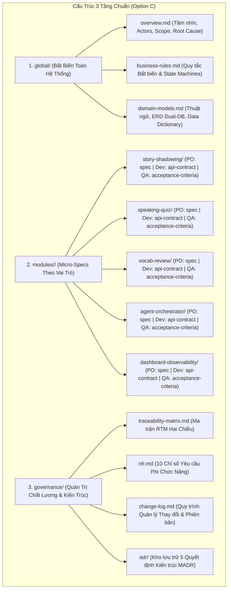
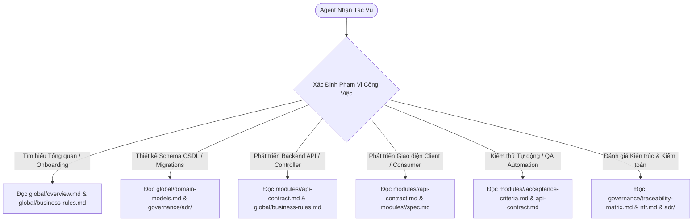

# aha-mind-agents — Requirement Analysis Package (Enterprise Granular Architecture)

> **Phiên bản:** 1.0 (Baseline — Option C Architecture)  
> **Phương pháp luận:** AI-Driven Context Engineering & Progressive Disclosure  
> **Tác giả:** Anh Tú — Giảng viên CNTT & Technical Writer

---

## 1. Tổng Quan Kiến Trúc Đặc Tả (Architecture Overview)

Hệ thống đặc tả yêu cầu phần mềm của `aha-mind-agents` được tổ chức theo **Option C (Enterprise Granular Architecture)**. Cấu trúc này giải quyết triệt để vấn đề quá tải cửa sổ ngữ cảnh (*Context Window Exhaustion*) và hiện tượng *Lost in the Middle* khi các AI Coding Agent (Claude, Gemini, Cursor) làm việc với các hệ thống phần mềm phức tạp.

Toàn bộ tri thức dự án được phân rã thành **3 tầng cấu trúc độc lập**:

---

## 2. Bản Đồ Điều Hướng Ngữ Cảnh Cho AI Coding Agent (JIT Context Router)

Khi AI Agent thực hiện một tác vụ cụ thể trong quy trình SDLC (lập trình, viết test, sửa lỗi, review kiến trúc), **TUYỆT ĐỐI KHÔNG ĐỌC TOÀN BỘ THƯ MỤC CÙNG LÚC**. Hãy tuân thủ sơ đồ rẽ nhánh **Just-in-Time (JIT) Context Loading**:

---

## 3. Danh Mục Tài Liệu Chi Tiết (Document Directory)

### 3.1 Tầng Bất Biến Toàn Cục (`global/`)
* 📄 [`overview.md`](global/overview.md) — Tầm nhìn sản phẩm, phân tích nguyên nhân gốc rễ (Root Cause Analysis), phân quyền tác nhân (RBAC) và phạm vi dự án.
* 📄 [`business-rules.md`](global/business-rules.md) — 7 quy tắc nghiệp vụ cốt lõi (Idempotency, Heartbeat 15s, PREP integrity, Token audit) và máy trạng thái vòng đời tác vụ.
* 📄 [`domain-models.md`](global/domain-models.md) — Thuật ngữ nghiệp vụ toàn cục (Glossary), sơ đồ ERD Dual-Database Cluster (`aha-tools` ⟷ `aha-mind`), và từ điển dữ liệu chi tiết.

### 3.2 Tầng Micro-Specs Theo Bounded Contexts (`modules/`)
* 🧩 **Story Shadowing Module (`modules/story-shadowing/`):**
  * 📋 [`spec.md`](modules/story-shadowing/spec.md) — Đặc tả nghiệp vụ (PO/BA), User Stories & Sequence Diagrams.
  * 🔌 [`api-contract.md`](modules/story-shadowing/api-contract.md) — Hợp đồng HTTP REST & SSE Streaming cho lập trình viên.
  * ✅ [`acceptance-criteria.md`](modules/story-shadowing/acceptance-criteria.md) — Bộ tiêu chí chấp nhận chuẩn Gherkin cho QA Automation.
* 🧩 **Speaking Quiz Module (`modules/speaking-quiz/`):**
  * 📋 [`spec.md`](modules/speaking-quiz/spec.md) — Đặc tả phương pháp giàn giáo tư duy phản biện PREP Framework và tích hợp FSRS.
  * 🔌 [`api-contract.md`](modules/speaking-quiz/api-contract.md) — Hợp đồng tạo Job sinh câu hỏi và truy vấn chi tiết.
  * ✅ [`acceptance-criteria.md`](modules/speaking-quiz/acceptance-criteria.md) — Tiêu chí nghiệm lưu trữ, tự động thử lại khi thiếu thành phần PREP và bơm từ vựng FSRS.
* 🧩 **Vocab Review Module (`modules/vocab-review/`):**
  * 📋 [`spec.md`](modules/vocab-review/spec.md) — Đặc tả động cơ ôn tập giãn cách FSRS v4, 3-tier Distractor Pool và tuần hoàn Speaking.
  * 🔌 [`api-contract.md`](modules/vocab-review/api-contract.md) — Hợp đồng HTTP REST (Session, Submit, Due Count) và Service Interface nội bộ.
  * ✅ [`acceptance-criteria.md`](modules/vocab-review/acceptance-criteria.md) — Tiêu chí nghiệm thu thuật toán FSRS, sinh phương án nhiễu và bơm từ vựng.
* 🧩 **Agent Orchestrator Module (`modules/agent-orchestrator/`):**
  * 📋 [`spec.md`](modules/agent-orchestrator/spec.md) — Đặc tả động cơ điều phối hợp nhất, Open-Closed Plugin Architecture.
  * 🔌 [`api-contract.md`](modules/agent-orchestrator/api-contract.md) — Hợp đồng `/api/agents/:agentId/:pipeline` và khám phá plugin.
  * ✅ [`acceptance-criteria.md`](modules/agent-orchestrator/acceptance-criteria.md) — Tiêu chí kiểm định xung nhịp Heartbeat 15s và Dual Emit Pattern.
* 🧩 **Dashboard & Observability Module (`modules/dashboard-observability/`):**
  * 📋 [`spec.md`](modules/dashboard-observability/spec.md) — Đặc tả hệ thống giám sát thời gian thực và quản trị tham số động.
  * 🔌 [`api-contract.md`](modules/dashboard-observability/api-contract.md) — Hợp đồng SSE Fan-out, thống kê metrics và quản lý cấu hình.
  * ✅ [`acceptance-criteria.md`](modules/dashboard-observability/acceptance-criteria.md) — Tiêu chí nghiệm thu bảng điều khiển và cập nhật Prompt không restart server.

### 3.3 Tầng Quản Trị Chất Lượng & Kiến Trúc (`governance/`)
* 📊 [`nfr.md`](governance/nfr.md) — 10 tiêu chuẩn yêu cầu phi chức năng (Performance, Quota Defense, Longevity, Isolation).
* 🔗 [`traceability-matrix.md`](governance/traceability-matrix.md) — Ma trận RTM truy xuất hai chiều giữa FR, US, AC, API và Automated Test.
* 📝 [`change-log.md`](governance/change-log.md) — Lịch sử phiên bản và quy trình quản lý yêu cầu thay đổi (CR Protocol).
* 🏛️ **Architecture Decision Records ([`adr/`](governance/adr/README.md)):**
  * [ADR-001](governance/adr/001-initial-architecture.md) — Kiến Trúc Decoupled Multi-Agent Engine & Direct SSE Streaming
  * [ADR-002](governance/adr/002-dual-database-cluster-strategy.md) — Chiến Lược Phân Tách CSDL Kép (aha-tools ⟷ aha-mind)
  * [ADR-003](governance/adr/003-redis-bullmq-execution.md) — Kiến Trúc Xử Lý Hàng Đợi Bất Đồng Bộ & Redis Pub/Sub
  * [ADR-004](governance/adr/004-context-idempotency-protocol.md) — Giao Thức Cache Idempotency Dựa Trên Dấu Vân Tay Dữ Liệu
  * [ADR-005](governance/adr/005-gemini-rate-limiter-queue.md) — Cơ Chế Hàng Đợi Token Rate Limiter Phòng Ngừa Lỗi 429 Quota

---

## 4. Ngân Sách Token & Tối Ưu Hóa Ngữ Cảnh (Token Budgets)

| Thư mục / Tài liệu | Trách nhiệm cốt lõi | Ước tính Token | Đối tượng thụ hưởng |
|---|---|---|---|
| **`global/`** | Quy tắc bất biến hệ thống, thuật ngữ và ERD | ~3,500 tokens | Toàn bộ Agent / Tech Lead |
| **`modules/`** | Micro-specs chia cắt theo module độc lập | ~1,800 tokens / module | Developer / Tester / PO |
| **`governance/`** | Tiêu chuẩn NFR, ma trận RTM và kho ADR | ~3,200 tokens | Architect / Code Reviewer |

---

*Made by Anh Tu - Share to be share*
