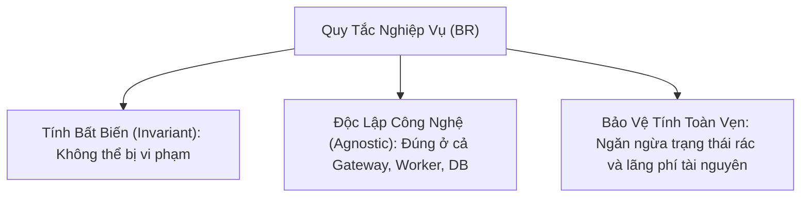
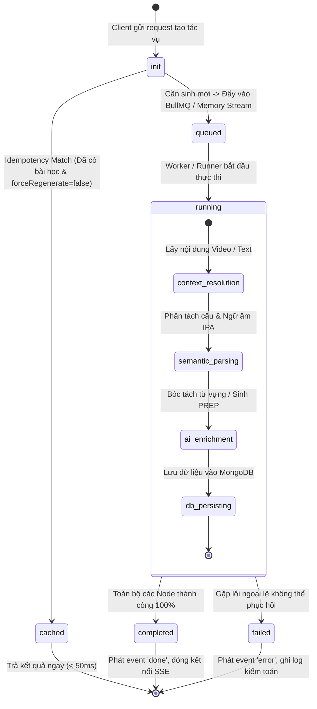

# Global 02 — Business Rules & State Machines: aha-mind-agents

> **Tài liệu cha:** [Requirement Analysis Package](../README.md)  
> **Phiên bản:** 1.0 (Baseline — Enterprise Granular Architecture)  
> **Tầng kiến trúc:** `global/` (System-Wide Invariants & Business Constraints)  
> **Tác giả:** Anh Tú — Giảng viên CNTT & Technical Writer

---

## 1. Định Nghĩa Cốt Lõi (Definition Anatomy)

> **Business Rule (Quy tắc Nghiệp vụ - BR)** là *một khẳng định chuẩn tắc bất biến* định nghĩa hoặc hạn chế các khía cạnh vận hành của hệ thống. Quy tắc nghiệp vụ hoàn toàn độc lập với giao diện người dùng (UI) và hạ tầng lưu trữ vật lý, đóng vai trò là **Nguồn Chân Lý Duy Nhất (Single Source of Truth)** kiểm soát tính toàn vẹn của dữ liệu và luồng chuyển đổi trạng thái.

### Giải Phẫu Cấu Trúc:
* **Chuẩn tắc (Normative):** Là luật lệ bắt buộc thực thi, không mang tính gợi ý hay khuyến nghị.
* **Hạn định trạng thái (Behavioral Constraint):** Ngăn chặn hệ thống rơi vào trạng thái bất hợp lệ (ví dụ: chạy trùng lặp khi đã có kết quả, lưu câu hỏi thiếu thành phần PREP).
* **Bảo vệ tài nguyên (Cost & Resource Safeguard):** Hạn chế tối đa chi phí tiêu tốn token của LLM và GPU tổng hợp âm thanh.

---

## 2. Danh Mục Quy Tắc Nghiệp Vụ Cốt Lõi (Core Business Rules)

| Mã BR | Phát biểu Quy tắc Nghiệp vụ | Thực thể tác động | Cơ chế cưỡng chế kỹ thuật | Trạng thái |
|---|---|---|---|---|
| **BR-01** | **Tính Bất Biến theo Ngữ Cảnh (Idempotency Invariant):** Khi nhận yêu cầu xử lý cùng một `videoId` hoặc cùng mã băm nội dung `textHash` và `forceRegenerate === false`, hệ thống BẮT BUỘC tái sử dụng bài học có sẵn trong CSDL `storybooks` và phản hồi ngay trong $< 50\text{ms}$, KHÔNG ĐƯỢC gọi lại mô hình AI. | `Storybook` | MongoDB Unique / Index Query trước khi dispatch Job | ✅ Bắt buộc |
| **BR-02** | **Ràng Buộc Phụ Thuộc Khảo Sát (Question Dependency Invariant):** Tác vụ sinh câu hỏi Speaking Quiz BẮT BUỘC phải tham chiếu đến một `storybookId` hợp lệ. Nếu bài học này đã có câu hỏi tương ứng và `forceRegenerate === false`, trả về bản ghi có sẵn từ `speaking_questions`. | `SpeakingQuestion` | Foreign Key / Validation Pipe & Query Check | ✅ Bắt buộc |
| **BR-03** | **Tính Toàn Vẹn Cấu Trúc Giàn Giáo PREP (PREP Framework Integrity):** Mỗi câu hỏi Speaking Quiz BẮT BUỘC phải chứa đủ 4 thành phần phản biện: **Point (Luận điểm)**, **Reason (Luận cứ)**, **Example (Dẫn chứng)**, và **Point/Conclusion (Khẳng định kết luận)**. Dữ liệu thiếu thành phần sẽ bị từ chối lưu CSDL. | `SpeakingQuestion` | Zod Schema Validation & Retry Parser | ✅ Bắt buộc |
| **BR-04** | **Bảo Toàn Kết Nối Serverless (SSE Heartbeat Invariant):** Mọi kết nối SSE mở từ Gateway trên môi trường Serverless (Vercel) BẮT BUỘC phải phát sự kiện `ping` định kỳ mỗi **15 giây** một lần để ngăn chặn cơ chế đóng kết nối ngầm (Idle Timeout). | `SseStream` | RxJS Timer / Interval Merge Stream | ✅ Bắt buộc |
| **BR-05** | **Kênh Phát Sóng Kép (Dual Emit Observability Invariant):** Mọi sự kiện tiến trình (`ProgressEvent`) phát sinh từ các Node của Agent BẮT BUỘC phải được phát đồng thời qua 2 kênh: HTTP SSE trực tiếp cho Client gọi API và Redis Pub/Sub (`dashboard:events`) cho Admin Dashboard. | `JobExecution` | `writeSseEvent()` song song `redisPubSub.publishEvent()` | ✅ Bắt buộc |
| **BR-06** | **Kiểm Toán & Định Lượng Tiêu Thụ Token (Strict Token Audit Trail):** Mọi chu kỳ thực thi Agent (thành công hoặc thất bại) BẮT BUỘC phải lưu một bản ghi nhật ký kiểm toán vào CSDL `aha-mind.agent_exec_logs` bao gồm: `jobId`, `agentId`, `pipeline`, `durationMs`, số lượng `tokens` và `cost`. | `AgentExecLog` | Post-execution Interceptor & MongoDB Insert | ✅ Bắt buộc |
| **BR-07** | **Điều Tiết Tải Tránh Lỗi 429 (Gemini Rate Limiter & Backoff):** Mọi yêu cầu gọi Google Gemini API BẮT BUỘC phải đi qua hàng đợi điều tiết token (`GeminiRateLimiterService`) để tuân thủ ngưỡng hạn mức RPM/TPM, tự động chờ và thử lại khi quá tải. | `GeminiService` | Token Bucket / Leaky Bucket In-Memory Queue | ✅ Bắt buộc |

---

## 3. Máy Trạng Thái Thực Thi Tác Vụ (Execution State Machines)

Luồng vòng đời của một tác vụ Agent từ lúc tiếp nhận đến khi hoàn tất hoặc thất bại tuân theo máy trạng thái hữu hạn (FSM):

---

## 4. Ma Trận Ghép Cặp Trạng Thái & Tính Nhất Quán (Consistency Matrix)

| Thao tác nghiệp vụ | Trạng thái nguồn | Trạng thái đích | Ràng buộc giao dịch & Toàn vẹn dữ liệu |
|---|---|---|---|
| **Kích hoạt Job** | Khởi tạo ban đầu | `cached` hoặc `queued` | Kiểm tra MongoDB Index duy nhất trước khi cấp phát `jobId`. |
| **Bắt đầu Pipeline** | `queued` | `running` | Ghi nhận thời điểm bắt đầu `startedAt`, phát sự kiện `status: running`. |
| **Cập nhật Tiến độ** | `running` | `running` | Tăng chỉ số phần trăm (`progress: 0 -> 100`), phát song song HTTP SSE và Redis Pub/Sub. |
| **Hoàn thành Tác vụ**| `running` | `completed` | Lưu bài học vào CSDL `storybooks` / `speaking_questions`, ghi log vào `agent_exec_logs`. |
| **Xảy ra Lỗi** | `running` | `failed` | Ghi lại nguyên nhân lỗi `errorMessage`, phát event lỗi cho Client, giải phóng tài nguyên. |

---

*Made by Anh Tu - Share to be share*
