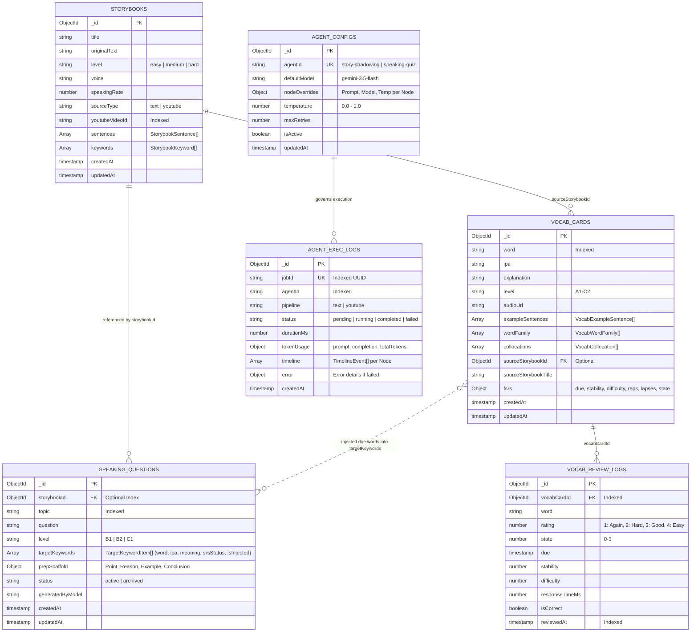

# Global 03 — Domain Models & Schema: aha-mind-agents

> **Tài liệu cha:** [Requirement Analysis Package](../README.md)  
> **Phiên bản:** 1.0 (Baseline — Enterprise Granular Architecture)  
> **Tầng kiến trúc:** `global/` (Domain Models, Ubiquitous Language & Schemas)  
> **Tác giả:** Anh Tú — Giảng viên CNTT & Technical Writer

---

## 1. Thuật Ngữ Nghiệp Vụ Toàn Cục (Ubiquitous Language / Glossary)

| Thuật ngữ (English) | Định nghĩa Kỹ thuật / Học thuật | Ý nghĩa Nghiệp vụ trong aha-mind-agents |
|---|---|---|
| **Storybook** | Thực thể bài học đa phương tiện hoàn chỉnh bao gồm danh sách câu, từ vựng trọng tâm, audio base64 và căn chỉnh phiên âm IPA. | Đơn vị học tập cốt lõi cho tính năng Speech Shadowing trên PWA `aha-tools`. |
| **Phonetic Alignment (IPA)** | Ánh xạ 1:1 từng từ trong câu văn với chuỗi ký tự bảng phiên âm quốc tế (International Phonetic Alphabet). | Hỗ trợ giao diện Client tô sáng từ ngữ theo thời gian thực (*Word-by-word highlighting*) khi phát âm thanh. |
| **Speaking Question** | Thực thể câu hỏi luyện nói phản xạ kèm theo giàn giáo lập luận đa tầng. | Kích thích phản xạ tư duy và giúp người học rèn luyện kỹ năng nói độc thoại hoặc đối thoại. |
| **PREP Scaffold** | Mô hình giàn giáo 4 pha: Point (Luận điểm) $\rightarrow$ Reason (Luận cứ) $\rightarrow$ Example (Dẫn chứng) $\rightarrow$ Conclusion (Kết luận). | Chuẩn hóa tư duy phản biện quốc tế cho câu trả lời của học viên theo các bậc CEFR (B1, B2, C1). |
| **Agent Exec Log** | Bản ghi nhật ký kiểm toán ghi nhận toàn bộ chu kỳ thực thi của một tác vụ Agent. | Phục vụ Observability, giám sát Token tiêu thụ, độ trễ từng Node và truy vết lỗi. |
| **Agent Config** | Cấu hình tham số điều khiển và System Prompt động theo từng Node của Agent. | Cho phép Admin ghi đè model LLM, temperature và prompt mà không cần sửa code. |
| **Dual Emit Pattern** | Mẫu phát tán sự kiện kép: một luồng trực tiếp về HTTP SSE của Client, một luồng phát sóng qua Redis Pub/Sub. | Đảm bảo tính khả dụng cao cho người dùng cuối đồng thời phục vụ màn hình giám sát tập trung. |
| **FSRS (Free Spaced Repetition Scheduler)** | Thuật toán lập lịch lặp lại ngắt quãng hiện đại dựa trên mô hình DSR (Difficulty - Stability - Retrievability), thay thế thuật toán SM-2 cổ điển. | Tính toán chu kỳ giãn cách tối ưu cho từng thẻ từ vựng dựa trên lịch sử phản xạ của người học. |
| **Distractor Pool** | Ngân hàng phương án gây nhiễu cho câu hỏi trắc nghiệm ngữ nghĩa và Cloze Test theo cơ chế 3 tầng cô lập (Storybook $\rightarrow$ CEFR $\rightarrow$ Global). | Tạo ra các lựa chọn sai hợp lý, tự nhiên, không trùng đáp án đúng và không trùng lặp nhau. |
| **Injected Vocabulary** | Các từ vựng đến hạn ôn tập (`due`) hoặc có độ vững chắc thấp được tự động đưa vào danh sách `targetKeywords` của đề Speaking Quiz. | Khép kín chu trình học tập: chuyển hóa từ vựng từ nhận diện bị động sang phản xạ nói chủ động. |

---

## 2. Sơ Đồ Quan Hệ Thực Thể (Entity Relationship Diagram - ERD)

Hệ thống quản lý dữ liệu trên mô hình **Dual Database Cluster** (MongoDB Atlas) phân định rõ ranh giới giữa Dữ liệu Nghiệp vụ Học tập (`aha-tools`) và Dữ liệu Vận hành / Giám sát (`aha-mind`):

---

## 3. Từ Điển Dữ Liệu & Ràng Buộc Toàn Vẹn (Data Dictionary)

### 3.1. Thực thể: `storybooks` (Database: `aha-tools`)
* `_id` (`ObjectId`, PK): Định danh duy nhất của bài học.
* `title` (`string`, Bắt buộc): Tiêu đề bài đọc hoặc tiêu đề video YouTube.
* `originalText` (`string`, Bắt buộc): Văn bản gốc toàn bài.
* `youtubeVideoId` (`string`, Tùy chọn, Đánh chỉ mục Index): ID video YouTube 11 ký tự dùng cho cơ chế Idempotency kiểm tra trùng lặp.
* `sentences` (`Array<StorybookSentence>`, Bắt buộc): Mảng danh sách các câu đã tách. Mỗi câu chứa:
  * `id` (`number`): Số thứ tự câu (1, 2, ...).
  * `text` (`string`): Văn bản của câu.
  * `audioBase64` (`string`): File âm thanh MP3 mã hóa Base64 phục vụ phát audio ngay trên Client.
  * `words` (`Array<{ word: string, ipa?: string }>`): Danh sách từ ngữ kèm ký tự ngữ âm IPA.
  * `startMs` / `endMs` (`number`): Mốc thời gian bắt đầu và kết thúc (nếu bóc tách từ video).
* `keywords` (`Array<StorybookKeyword>`): Danh sách từ vựng trọng tâm kèm giải thích tiếng Việt, cấp độ CEFR, Word Family và Collocations.
* `level` (`string`, Enum: `easy | medium | hard`): Độ khó phân loại bài học.
* `sourceType` (`string`, Enum: `text | youtube`): Nguồn tài nguyên đầu vào.

### 3.2. Thực thể: `speaking_questions` (Database: `aha-tools`)
* `_id` (`ObjectId`, PK): Định danh duy nhất của câu hỏi.
* `storybookId` (`ObjectId`, FK, Đánh chỉ mục Index): Tham chiếu đến bài học Storybook nguồn.
* `topic` (`string`, Bắt buộc): Chủ đề thảo luận bài nói.
* `question` (`string`, Bắt buộc): Câu hỏi kích thích tư duy phản biện.
* `level` (`string`, Enum: `B1 | B2 | C1`, Bắt buộc): Cấp độ năng lực ngôn ngữ theo khung CEFR.
* `targetKeywords` (`Array<TargetKeywordItem>`): Danh sách từ vựng trọng tâm. Mỗi phần tử chứa:
  * `word` (`string`, Bắt buộc): Từ vựng.
  * `ipa` (`string`, Tùy chọn): Phiên âm IPA chuẩn quốc tế.
  * `meaning` (`string`, Bắt buộc): Nghĩa / lời giải thích ngữ cảnh.
  * `srsStatus` (`string`, Enum: `'due' | 'learning' | 'mastered' | 'new' | 'unsaved'`): Trạng thái trí nhớ FSRS của từ.
  * `isInjected` (`boolean`, Mặc định: `false`): Cờ đánh dấu từ vựng được tự động bơm từ FSRS engine để kích hoạt phản xạ nói.
* `prepScaffold` (`Object`, Bắt buộc): Cấu trúc giàn giáo tư duy PREP, bắt buộc chứa 4 giai đoạn (`point`, `reason`, `example`, `conclusion`), mỗi giai đoạn có:
  * `stage` (`string`): Tên giai đoạn (`point | reason | example | conclusion`).
  * `title` (`string`): Tiêu đề giai đoạn.
  * `signposts` (`string[]`): Các liên từ dẫn dắt câu (Signpost words, ví dụ: *"First and foremost", "For instance"*).
  * `hint` (`string`): Gợi ý phản xạ cho người học.
  * `modelAnswer` (`string`): Câu trả lời mẫu chuẩn ngữ pháp và phát âm, tích hợp tự nhiên các từ vựng mục tiêu.

### 3.3. Thực thể: `agent_configs` (Database: `aha-mind`)
* `_id` (`ObjectId`, PK): Định danh bản ghi cấu hình.
* `agentId` (`string`, Unique, Bắt buộc): Mã tác nhân định danh duy nhất (`story-shadowing`, `speaking-quiz`).
* `defaultModel` (`string`, Mặc định: `'gemini-3.5-flash'`): Mô hình LLM mặc định.
* `nodeOverrides` (`Object`): Ánh xạ ghi đè theo từng Node (`systemPrompt`, `model`, `temperature`).
* `temperature` (`number`, `0.0 - 1.0`): Độ sáng tạo suy luận.
* `maxRetries` (`number`, Mặc định: `2`): Số lần thử lại tối đa khi LLM lỗi.

### 3.4. Thực thể: `agent_exec_logs` (Database: `aha-mind`)
* `_id` (`ObjectId`, PK): Định danh log.
* `jobId` (`string`, Unique, Bắt buộc): Mã tác vụ duy nhất dạng UUID.
* `agentId` (`string`, Bắt buộc): Tên agent thực thi.
* `pipeline` (`string`, Bắt buộc): Pipeline cụ thể (`youtube`, `text`, `generate-quiz`).
* `status` (`string`, Enum: `'pending' | 'running' | 'completed' | 'failed'`): Trạng thái cuối cùng.
* `durationMs` (`number`): Tổng thời gian thực thi (mili-giây).
* `tokenUsage` (`Object`): Thống kê `promptTokens`, `completionTokens`, `totalTokens`.
* `timeline` (`Array<TimelineEvent>`): Dòng thời gian chi tiết từng Node (`nodeName`, `status`, `durationMs`, `timestamp`).

### 3.5. Thực thể: `vocab_cards` (Database: `aha-tools`)
* `_id` (`ObjectId`, PK): Định danh duy nhất của thẻ từ vựng.
* `word` (`string`, Bắt buộc, Đánh chỉ mục Index): Từ vựng tiếng Anh.
* `ipa` (`string`, Tùy chọn): Ký tự ngữ âm quốc tế.
* `explanation` (`string`, Bắt buộc): Nghĩa và giải thích tiếng Việt.
* `level` (`string`, Enum: `'A1' | 'A2' | 'B1' | 'B2' | 'C1' | 'C2'`, Mặc định: `'B1'`): Cấp độ CEFR.
* `audioUrl` (`string`, Tùy chọn): Đường dẫn file phát âm thanh mẫu.
* `exampleSentences` (`Array<{ sentence: string, answer: string }>`): Danh sách câu ví dụ chứa từ (phục vụ sinh Cloze Test).
* `wordFamily` (`Array<VocabWordFamily>`): Danh sách họ hàng từ loại (danh từ, động từ, tính từ,...).
* `collocations` (`Array<VocabCollocation>`): Các cụm từ kết hợp tự nhiên phổ biến.
* `sourceStorybookId` (`ObjectId`, FK, Tùy chọn): Tham chiếu bài học Storybook nguồn đã lưu từ.
* `sourceStorybookTitle` (`string`, Tùy chọn): Tên bài học Storybook nguồn.
* `fsrs` (`Object`, Bắt buộc): Trạng thái thuật toán FSRS v4:
  * `due` (`Date`, Đánh chỉ mục Index): Mốc thời gian đến hạn cần ôn tập kế tiếp.
  * `stability` (`number`): Độ vững chắc của trí nhớ (tính bằng số ngày lưu giữ).
  * `difficulty` (`number`): Độ khó nội tại của từ vựng (thang điểm 1 - 10).
  * `elapsed_days` (`number`): Số ngày thực tế đã trôi qua kể từ lần ôn trước.
  * `scheduled_days` (`number`): Khoảng thời gian giãn cách đã được lên lịch.
  * `reps` (`number`): Tổng số lần người học đã ôn tập từ này.
  * `lapses` (`number`): Số lần người học quên từ (trả lời sai).
  * `state` (`number`, Enum: `0: New | 1: Learning | 2: Review | 3: Relearning`): Trạng thái học tập hiện tại.
  * `last_review` (`Date`, Tùy chọn): Mốc thời gian của lần ôn tập gần nhất.

### 3.6. Thực thể: `vocab_review_logs` (Database: `aha-tools`)
* `_id` (`ObjectId`, PK): Định danh bản ghi nhật ký ôn tập.
* `vocabCardId` (`ObjectId`, FK, Đánh chỉ mục Index): Tham chiếu đến thẻ từ vựng trong `vocab_cards`.
* `word` (`string`, Bắt buộc): Từ vựng tại thời điểm ôn tập.
* `rating` (`number`, Enum: `1: Again | 2: Hard | 3: Good | 4: Easy`): Đánh giá phản xạ người học.
* `state` (`number`): Trạng thái thẻ tại thời điểm đánh giá.
* `due` (`Date`): Ngày đến hạn mới được FSRS tính toán.
* `stability` (`number`): Độ vững chắc mới của thẻ.
* `difficulty` (`number`): Độ khó mới của thẻ.
* `responseTimeMs` (`number`): Thời gian phản xạ trả lời câu hỏi của người học (mili-giây).
* `isCorrect` (`boolean`, Bắt buộc): Kết quả đúng hay sai của câu trả lời.
* `reviewedAt` (`Date`, Đánh chỉ mục Index, Mặc định: `Date.now`): Thời điểm hoàn tất ôn tập.

---

## 4. Ánh Xạ Ràng Buộc Kiến Trúc & Quyết Định (ADR Mapping)
* 📄 [ADR-001: Kiến Trúc Hybrid Micro-Backend & Direct SSE Streaming](../governance/adr/001-initial-architecture.md)
* 📄 [ADR-002: Dual-Cluster Database Persistence Strategy (aha-tools ⟷ aha-mind)](../governance/adr/002-dual-database-cluster-strategy.md)
* 📄 [ADR-003: Redis Pub/Sub & BullMQ Decoupled Job Execution Pattern](../governance/adr/003-redis-bullmq-execution.md)
* 📄 [ADR-004: Context Idempotency Caching Protocol](../governance/adr/004-context-idempotency-protocol.md)
* 📄 [ADR-005: Gemini Rate Limiter Queue for 429 Prevention](../governance/adr/005-gemini-rate-limiter-queue.md)

---

*Made by Anh Tu - Share to be share*
