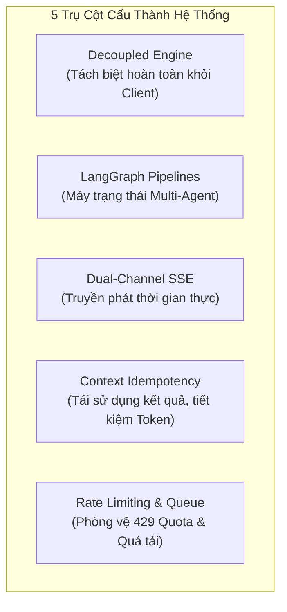
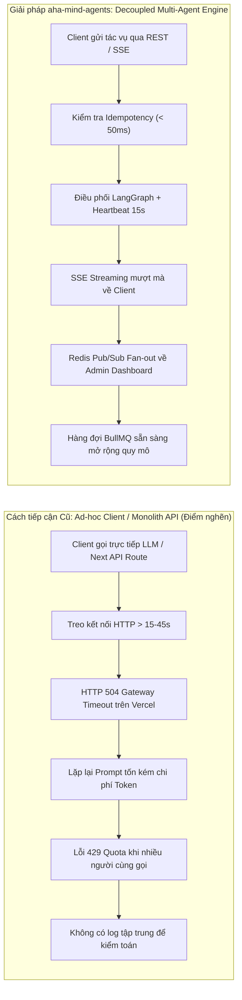

# Global 01 — Business Goal, Scope & Context: aha-mind-agents

> **Tài liệu cha:** [Requirement Analysis Package](../README.md)  
> **Phiên bản:** 1.0 (Baseline — Enterprise Granular Architecture)  
> **Tầng kiến trúc:** `global/` (System-Wide Invariants & Global Context)  
> **Tác giả:** Anh Tú — Giảng viên CNTT & Technical Writer

---

## 1. Định Nghĩa Cốt Lõi (Definition Anatomy)

> **Autonomous Multi-Agent Orchestration Platform (Nền tảng Điều phối Đa Tác nhân Tự trị)** là *hệ thống backend chuyên biệt* áp dụng kiến trúc hướng sự kiện (*Event-Driven Architecture*) và máy trạng thái (*State Graph Machine*) để phân tách, điều phối và thực thi các chuỗi tác vụ AI phức tạp, cung cấp luồng phản hồi thời gian thực (*Real-time Streaming*) và đảm bảo khả năng quan sát toàn diện (*Observability*) độc lập với giao diện người dùng cuối.

### Giải Phẫu Từ Khóa Kỹ Thuật (Anatomical Keyword Breakdown):
1. **Decoupled Backend Engine (Backend tách rời):** Loại bỏ sự phụ thuộc chặt chẽ (*tight coupling*) giữa giao diện Frontend (`aha-tools` PWA) và logic AI. Mọi tác vụ suy luận LLM, tổng hợp giọng nói TTS, phân tích ngữ âm học đều được đóng gói tại máy chủ backend chuyên trách.
2. **Multi-Agent Pipeline (Chuỗi tác nhân đa nhiệm):** Thay vì một lệnh Prompt khổng lồ duy nhất (dễ gây ảo giác - Hallucination), tác vụ được chia nhỏ thành đồ thị có hướng tuần tự hoặc song song (*StateGraph*) được quản lý bởi LangGraph: trích xuất phụ đề $\rightarrow$ phân tích câu $\rightarrow$ gắn nhãn IPA $\rightarrow$ làm giàu từ vựng $\rightarrow$ sinh giàn giáo phản biện PREP.
3. **Dual-Channel Real-time Streaming (Truyền phát 2 kênh đồng thời):** Sử dụng Server-Sent Events (SSE) để truyền trực tiếp tiến trình từng Node về cho người dùng gọi API, đồng thời phát sóng (*Broadcast*) qua Redis Pub/Sub về màn hình điều khiển Admin Dashboard.
4. **Idempotency by Content Hash (Tính bất biến theo nội dung):** Trước khi tiêu tốn tài nguyên gọi mô hình ngôn ngữ lớn (Gemini), hệ thống kiểm tra dấu vân tay dữ liệu (`videoId` hoặc `textHash`). Nếu bài học đã tồn tại, phản hồi tức thì trong $< 50\text{ms}$, tiết kiệm 100% chi phí Token.
5. **Observability & Rate Limiting (Khả năng quan sát & Hạn định tốc độ):** Giám sát chi tiết lượng tiêu thụ Token (Prompt, Completion, Reasoning) và độ trễ theo từng Node; tích hợp hàng đợi giới hạn RPM/TPM nhằm ngăn chặn triệt để lỗi `429 Too Many Requests`.

---

## 2. Phân Tích Nguyên Nhân Gốc Rễ (Root Cause Analysis)

Tại sao `aha-mind-agents` cần phải ra đời? Hãy so sánh sự khác biệt giữa phương thức tiếp cận đơn khối truyền thống và kiến trúc tác nhân phân tán hiện đại:

### Trade-off Analysis (Đánh Đổi Kỹ Thuật):
* **Ưu điểm (+):** 
  * Giải quyết triệt để lỗi ngắt kết nối HTTP timeout (Vercel Serverless Server timeout).
  * Tiết kiệm chi phí vận hành API Gemini nhờ cơ chế Cache Idempotency thông minh.
  * Độc lập nâng cấp các thuật toán Agent (Story Shadowing, Speaking Quiz) mà không cần deploy lại Frontend.
* **Chi phí đánh đổi (-):** 
  * Cần duy trì hạ tầng bổ trợ gồm MongoDB Atlas (lưu trạng thái bài học & log) và Redis Upstash (Pub/Sub & Queue).
  * Kiến trúc phức tạp hơn so với việc gọi trực tiếp API Gemini từ phía client.

---

## 3. Tác Nhân Hệ Thống & Phân Quyền (Actors & RBAC)

| Tác nhân (Actor) | Vai trò thực tế | Định danh (Role ID) | Quyền hạn cốt lõi |
|---|---|---|---|
| **Học viên (Learner)** | Người dùng cuối học ngoại ngữ qua PWA | `learner` | Gửi yêu cầu sinh bài học Shadowing, sinh câu hỏi Speaking Quiz, nhận tiến độ SSE trực tiếp. |
| **Giáo viên / Tác giả (Creator)** | Người biên soạn nội dung giáo trình | `creator` | Xem chi tiết bài học hoàn chỉnh, tinh chỉnh từ vựng, đánh giá giàn giáo PREP. |
| **Quản trị viên (Admin)** | Quản lý vận hành hệ thống | `admin` | Theo dõi real-time SSE stream qua Admin Dashboard, kiểm toán Token tiêu thụ, cấu hình Node Prompt. |
| **Hệ thống Nền (Worker Node)** | Tiến trình tự trị thực thi đồ thị Agent | `worker` | Lắng nghe BullMQ, thực thi LangGraph State Machine, cập nhật CSDL và phát sóng tiến độ. |

---

## 4. Phạm Vi Dự Án (Project Scope)

### 4.1. Trong phạm vi triển khai (In-Scope — Baseline)
* **Agent Story Shadowing:**
  * Chuyển đổi YouTube URL hoặc Raw Text thành bài tập Shadowing chuẩn quốc tế.
  * Tách câu, căn chỉnh phiên âm IPA từng từ (*Phonetic Alignment*).
  * Tổng hợp phát âm tự nhiên qua Google Cloud TTS.
  * Bóc tách và làm giàu từ vựng chuyên sâu (định nghĩa tiếng Việt, câu ví dụ, từ loại).
* **Agent Speaking Quiz:**
  * Phân tích nội dung bài học để sinh câu hỏi thảo luận phản xạ.
  * Tạo khung lập luận tư duy quốc tế **PREP (Point - Reason - Example - Point)**.
  * Phân tầng độ khó theo chuẩn khung tham chiếu Châu Âu (CEFR: A2, B1, B2).
* **Hạ tầng Điều phối & Quan sát (Orchestration & Observability):**
  * Unified Agent Controller định tuyến qua plugin interface.
  * Server-Sent Events (SSE) với xung nhịp giữ kết nối (Heartbeat Ping 15 giây).
  * Kênh phát sóng kép (Dual Emit Pattern) qua SSE và Redis Pub/Sub.
  * Quản lý lưu trữ kép trên MongoDB: `aha-tools` (dữ liệu học tập) và `aha-mind` (quản trị, log, prompt config).

### 4.2. Ngoài phạm vi triển khai (Out-of-Scope — Deferred)
* Đánh giá tự động phát âm giọng nói học viên bằng mô hình chấm điểm Speech Assessment (dành cho v2).
* Thanh toán và quản lý gói cước đăng ký của người dùng (thuộc trách nhiệm của auth/billing service ngoài).
* Ứng dụng di động Native (hiện tại hỗ trợ qua Web PWA của `aha-tools`).

---

*Made by Anh Tu - Share to be share*
