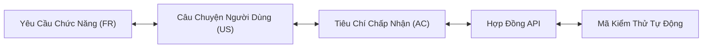

# Governance — Requirements Traceability Matrix (RTM)

> **Tài liệu cha:** [Requirement Analysis Package](../README.md)  
> **Phiên bản:** 1.0 (Baseline — Enterprise Granular Architecture)  
> **Tác giả:** Anh Tú — Giảng viên CNTT & Technical Writer

---

## 1. Định Nghĩa Cốt Lõi (Definition Anatomy)

> **Requirements Traceability Matrix (Ma Trận Truy Xuất Yêu Cầu - RTM)** là *bảng ánh xạ lưới hai chiều (Bi-directional Mapping Grid)* kết nối các Mục tiêu Nghiệp vụ, Yêu cầu Chức năng (FR), Câu chuyện Người dùng (US), Tiêu chí Chấp nhận (AC), Hợp đồng API (API Contracts) và Bộ Kiểm thử Tự động (Automated Test Suites).

* **Truy xuất Xuôi (Forward Traceability):** Đảm bảo 100% yêu cầu nghiệp vụ đều có code triển khai và có bài kiểm thử tương ứng (Không sót tính năng).
* **Truy xuất Ngược (Backward Traceability):** Đảm bảo không có dòng code nào là "mồ côi" hoặc dư thừa mà không phục vụ một giá trị nghiệp vụ rõ ràng.

---

## 2. Lưới Ma Trận Truy Xuất Toàn Diện (Comprehensive RTM Grid)

### 2.1. Module: Story Shadowing (`SHADOW`)
| Mã FR | Tên Tính Năng | User Story | Tiêu Chí Chấp Nhận (AC) | Hợp Đồng API | Mã Nguồn / Kiểm Thử | Trạng Thái |
|---|---|---|---|---|---|---|
| **FR-SHADOW-01** | Tạo bài từ YouTube | [`US-SHADOW-01`](../modules/story-shadowing/spec.md#us-shadow-01) | [`AC-SHADOW-01`](../modules/story-shadowing/acceptance-criteria.md#ac-shadow-01) | [`POST /jobs`](../modules/story-shadowing/api-contract.md#11-post-apiagentsstory-shadowingjobs) | `story-shadowing.controller.spec.ts` | ✅ Sẵn sàng |
| **FR-SHADOW-02** | Tạo bài từ Text | [`US-SHADOW-01`](../modules/story-shadowing/spec.md#us-shadow-01) | [`AC-SHADOW-02`](../modules/story-shadowing/acceptance-criteria.md#ac-shadow-02) | [`POST /jobs`](../modules/story-shadowing/api-contract.md#11-post-apiagentsstory-shadowingjobs) | `story-shadowing.service.spec.ts` | ✅ Sẵn sàng |
| **FR-SHADOW-03** | Tái sử dụng Idempotency | [`US-SHADOW-01`](../modules/story-shadowing/spec.md#us-shadow-01) | [`AC-SHADOW-03`](../modules/story-shadowing/acceptance-criteria.md#ac-shadow-03) | [`POST /jobs`](../modules/story-shadowing/api-contract.md#11-post-apiagentsstory-shadowingjobs) | `story-shadowing.worker.spec.ts` | ✅ Sẵn sàng |
| **FR-SHADOW-04** | Luồng tiến độ SSE | [`US-SHADOW-02`](../modules/story-shadowing/spec.md#us-shadow-02) | [`AC-SHADOW-04`](../modules/story-shadowing/acceptance-criteria.md#ac-shadow-04) | [`GET /jobs/:id/progress`](../modules/story-shadowing/api-contract.md#12-get-apiagentsstory-shadowingjobsjobidprogress) | `story-shadowing.controller.ts` | ✅ Sẵn sàng |
| **FR-SHADOW-05** | Truy vấn Storybook | [`US-SHADOW-01`](../modules/story-shadowing/spec.md#us-shadow-01) | [`AC-SHADOW-05`](../modules/story-shadowing/acceptance-criteria.md#ac-shadow-05) | [`GET /stories/:id`](../modules/story-shadowing/api-contract.md#13-get-apiagentsstory-shadowingstoriesid) | `story-shadowing.controller.spec.ts` | ✅ Sẵn sàng |

---

### 2.2. Module: Speaking Quiz (`QUIZ`)
| Mã FR | Tên Tính Năng | User Story | Tiêu Chí Chấp Nhận (AC) | Hợp Đồng API | Mã Nguồn / Kiểm Thử | Trạng Thái |
|---|---|---|---|---|---|---|
| **FR-QUIZ-01** | Tạo câu hỏi phản xạ | [`US-QUIZ-01`](../modules/speaking-quiz/spec.md#us-quiz-01) | [`AC-QUIZ-01`](../modules/speaking-quiz/acceptance-criteria.md#ac-quiz-01) | [`POST /jobs`](../modules/speaking-quiz/api-contract.md#11-post-apiagentsspeaking-quizjobs) | `speaking-quiz.controller.spec.ts` | ✅ Sẵn sàng |
| **FR-QUIZ-02** | Giàn giáo tư duy PREP | [`US-QUIZ-01`](../modules/speaking-quiz/spec.md#us-quiz-01) | [`AC-QUIZ-02`](../modules/speaking-quiz/acceptance-criteria.md#ac-quiz-02) | [`POST /jobs`](../modules/speaking-quiz/api-contract.md#11-post-apiagentsspeaking-quizjobs) | `speaking-quiz.service.spec.ts` | ✅ Sẵn sàng |
| **FR-QUIZ-03** | Tái sử dụng Idempotency | [`US-QUIZ-01`](../modules/speaking-quiz/spec.md#us-quiz-01) | [`AC-QUIZ-03`](../modules/speaking-quiz/acceptance-criteria.md#ac-quiz-03) | [`POST /jobs`](../modules/speaking-quiz/api-contract.md#11-post-apiagentsspeaking-quizjobs) | `speaking-quiz.worker.spec.ts` | ✅ Sẵn sàng |
| **FR-QUIZ-04** | Luồng tiến độ SSE | [`US-QUIZ-01`](../modules/speaking-quiz/spec.md#us-quiz-01) | [`AC-QUIZ-04`](../modules/speaking-quiz/acceptance-criteria.md#ac-quiz-04) | [`GET /jobs/:id/progress`](../modules/speaking-quiz/api-contract.md#12-get-apiagentsspeaking-quizjobsjobidprogress) | `speaking-quiz.controller.ts` | ✅ Sẵn sàng |
| **FR-QUIZ-05** | Truy vấn câu hỏi PREP | [`US-QUIZ-01`](../modules/speaking-quiz/spec.md#us-quiz-01) | [`AC-QUIZ-05`](../modules/speaking-quiz/acceptance-criteria.md#ac-quiz-05) | [`GET /questions/:id`](../modules/speaking-quiz/api-contract.md#13-get-apiagentsspeaking-quizquestionsid) | `speaking-question.schema.spec.ts` | ✅ Sẵn sàng |
| **FR-QUIZ-06** | Lồng ghép từ vựng FSRS | [`US-QUIZ-01`](../modules/speaking-quiz/spec.md#us-quiz-01) | [`AC-QUIZ-06`](../modules/speaking-quiz/acceptance-criteria.md#ac-quiz-06) | [`POST /jobs`](../modules/speaking-quiz/api-contract.md#11-post-apiagentsspeaking-quizjobs) | `prep-synthesizer.node.spec.ts` | ✅ Sẵn sàng |

---

### 2.3. Module: Agent Orchestrator (`ORCH`)
| Mã FR | Tên Tính Năng | User Story | Tiêu Chí Chấp Nhận (AC) | Hợp Đồng API | Mã Nguồn / Kiểm Thử | Trạng Thái |
|---|---|---|---|---|---|---|
| **FR-ORCH-01** | Đăng ký Plugin OCP | [`US-ORCH-01`](../modules/agent-orchestrator/spec.md#us-orch-01) | [`AC-ORCH-01`](../modules/agent-orchestrator/acceptance-criteria.md#ac-orch-01) | [`GET /api/agents`](../modules/agent-orchestrator/api-contract.md#11-get-apiagents) | `agents.module.ts` | ✅ Sẵn sàng |
| **FR-ORCH-02** | Thực thi Pipeline SSE | [`US-ORCH-01`](../modules/agent-orchestrator/spec.md#us-orch-01) | [`AC-ORCH-02`](../modules/agent-orchestrator/acceptance-criteria.md#ac-orch-02) | [`POST /:agentId/:pipeline`](../modules/agent-orchestrator/api-contract.md#13-post-apiagentsagentidpipeline) | `job-execution.service.ts` | ✅ Sẵn sàng |
| **FR-ORCH-03** | Heartbeat Ping 15s | [`US-ORCH-01`](../modules/agent-orchestrator/spec.md#us-orch-01) | [`AC-ORCH-03`](../modules/agent-orchestrator/acceptance-criteria.md#ac-orch-03) | [`POST /:agentId/:pipeline`](../modules/agent-orchestrator/api-contract.md#13-post-apiagentsagentidpipeline) | `job-execution.service.ts` | ✅ Sẵn sàng |
| **FR-ORCH-04** | Dual Emit Pattern | [`US-ORCH-01`](../modules/agent-orchestrator/spec.md#us-orch-01) | [`AC-ORCH-04`](../modules/agent-orchestrator/acceptance-criteria.md#ac-orch-04) | Nội bộ Runner | `redis-pubsub.service.ts` | ✅ Sẵn sàng |
| **FR-ORCH-05** | Rate Limiter Quota | [`US-ORCH-01`](../modules/agent-orchestrator/spec.md#us-orch-01) | [`AC-ORCH-05`](../modules/agent-orchestrator/acceptance-criteria.md#ac-orch-05) | Nội bộ Gemini Service | `gemini-rate-limiter.service.ts` | ✅ Sẵn sàng |

---

### 2.4. Module: Dashboard & Observability (`DASH`)
| Mã FR | Tên Tính Năng | User Story | Tiêu Chí Chấp Nhận (AC) | Hợp Đồng API | Mã Nguồn / Kiểm Thử | Trạng Thái |
|---|---|---|---|---|---|---|
| **FR-DASH-01** | Live Stream Real-time | [`US-DASH-01`](../modules/dashboard-observability/spec.md#us-dash-01) | [`AC-DASH-01`](../modules/dashboard-observability/acceptance-criteria.md#ac-dash-01) | [`GET /v1/dashboard/events`](../modules/dashboard-observability/api-contract.md#11-get-apiv1dashboardevents) | `dashboard.controller.ts` | ✅ Sẵn sàng |
| **FR-DASH-02** | Thống kê Metrics | [`US-DASH-01`](../modules/dashboard-observability/spec.md#us-dash-01) | [`AC-DASH-02`](../modules/dashboard-observability/acceptance-criteria.md#ac-dash-02) | [`GET /v1/dashboard/metrics`](../modules/dashboard-observability/api-contract.md#12-get-apiv1dashboardmetrics) | `dashboard.service.ts` | ✅ Sẵn sàng |
| **FR-DASH-03** | Nhật ký Logs Phân trang | [`US-DASH-01`](../modules/dashboard-observability/spec.md#us-dash-01) | [`AC-DASH-03`](../modules/dashboard-observability/acceptance-criteria.md#ac-dash-03) | [`GET /v1/dashboard/logs`](../modules/dashboard-observability/api-contract.md#13-get-apiv1dashboardlogs) | `dashboard.service.ts` | ✅ Sẵn sàng |
| **FR-DASH-04** | Cấu hình Agent Động | [`US-DASH-02`](../modules/dashboard-observability/spec.md#us-dash-02) | [`AC-DASH-04`](../modules/dashboard-observability/acceptance-criteria.md#ac-dash-04) | [`GET / PUT /configs/:agentId`](../modules/dashboard-observability/api-contract.md#14-get-put-apiv1dashboardconfigsagentid) | `dashboard.service.ts` | ✅ Sẵn sàng |

---

### 2.5. Module: Vocab Review (`VOCAB`)
| Mã FR | Tên Tính Năng | User Story | Tiêu Chí Chấp Nhận (AC) | Hợp Đồng API | Mã Nguồn / Kiểm Thử | Trạng Thái |
|---|---|---|---|---|---|---|
| **FR-VOCAB-01** | Sinh phiên trắc nghiệm | [`US-VOCAB-01`](../modules/vocab-review/spec.md#us-vocab-01) | [`AC-VOCAB-01`](../modules/vocab-review/acceptance-criteria.md#ac-vocab-01) | [`GET /session`](../modules/vocab-review/api-contract.md#11-get-apivocabreviewsession) | `vocab-review.service.spec.ts` | ✅ Sẵn sàng |
| **FR-VOCAB-02** | Nộp kết quả & FSRS | [`US-VOCAB-01`](../modules/vocab-review/spec.md#us-vocab-01) | [`AC-VOCAB-02`](../modules/vocab-review/acceptance-criteria.md#ac-vocab-02) | [`POST /submit`](../modules/vocab-review/api-contract.md#12-post-apivocabreviewsubmit) | `fsrs.service.spec.ts` | ✅ Sẵn sàng |
| **FR-VOCAB-03** | Thống kê từ đến hạn | [`US-VOCAB-01`](../modules/vocab-review/spec.md#us-vocab-01) | [`AC-VOCAB-03`](../modules/vocab-review/acceptance-criteria.md#ac-vocab-03) | [`GET /due-count`](../modules/vocab-review/api-contract.md#13-get-apivocabreviewdue-count) | `vocab-review.controller.spec.ts` | ✅ Sẵn sàng |
| **FR-VOCAB-04** | Trích xuất ứng viên SRS | [`US-VOCAB-02`](../modules/vocab-review/spec.md#us-vocab-02) | [`AC-VOCAB-04`](../modules/vocab-review/acceptance-criteria.md#ac-vocab-04) | Nội bộ Service | `context-resolver.node.spec.ts` | ✅ Sẵn sàng |

---

*Made by Anh Tu - Share to be share*

