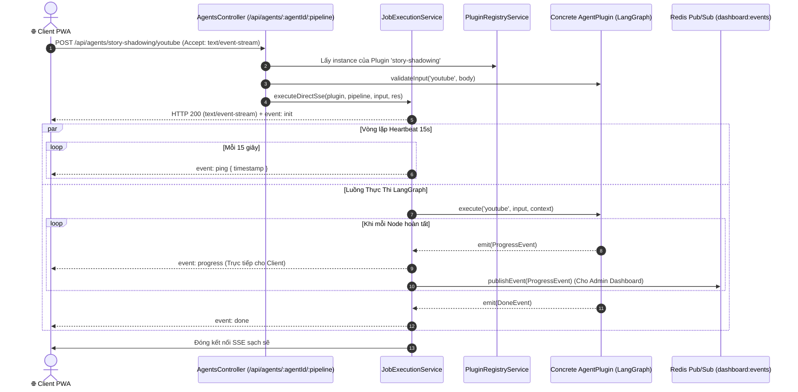

# Module Agent Orchestrator — Business Specification

> **Tài liệu cha:** [Requirement Analysis Package](../../README.md)  
> **Mã Module:** `ORCH` | **Tên miền nghiệp vụ:** Bộ Điều Phối & Động Cơ Thực Thi Agent Hợp Nhất (Core Orchestrator)  
> **Tài liệu liên kết:** [API Contract](api-contract.md) | [Acceptance Criteria](acceptance-criteria.md)  
> **Tác giả:** Anh Tú — Giảng viên CNTT & Technical Writer

---

## 1. Mục Tiêu Nghiệp Vụ (Business Objective)

Khi hệ thống mở rộng từ 2 Agent hiện tại lên 5, 10 hoặc 20 Agent trong tương lai (ví dụ: Grammar Coach, Pronunciation Evaluator, IELTS Writing Rater), việc mỗi Agent tự xây dựng một Gateway riêng lẻ, tự xử lý SSE và tự quản lý kết nối Vercel sẽ dẫn đến:
1. **Trùng lặp mã nguồn (Code Duplication):** Hàng chục controller xử lý SSE và đóng/mở header giống hệt nhau.
2. **Nguy cơ lỗi Timeout 504 trên Serverless:** Không có cơ chế xung nhịp định kỳ (*Heartbeat Ping*) thống nhất.
3. **Phân mảnh khả năng quan sát (Observability Fragmentation):** Admin Dashboard không thể có một chuẩn chung để lắng nghe sự kiện của toàn hệ thống.

**Agent Orchestrator** đóng vai trò là "Trái tim" của hệ thống, cung cấp:
* Một bộ khung cắm ghép **Plugin Architecture** tuân thủ nguyên lý *Open-Closed Principle (OCP)*.
* Một cổng vào duy nhất (`POST /api/agents/:agentId/:pipeline`) có khả năng điều phối mọi loại Agent.
* Cơ chế **Dual Emit Pattern** phát đồng thời SSE cho người dùng và Redis Pub/Sub cho Dashboard.
* Hàng phòng vệ **Gemini Rate Limiter** ngăn chặn triệt để lỗi `429 Too Many Requests`.

---

## 2. Yêu Cầu Chức Năng (Functional Requirements)

| Mã FR | Tên tính năng | Tác nhân | Tiền điều kiện | Hậu điều kiện | API Endpoint tương ứng | Tiêu chí chấp nhận (AC) |
|---|---|---|---|---|---|---|
| **FR-ORCH-01** | Khám phá & Đăng ký Plugin | Hệ thống / Admin | Plugin implement `AgentPlugin` | Metadata của Plugin được load vào Registry | [`GET /api/agents`](api-contract.md#11-get-apiagents) | [`AC-ORCH-01`](acceptance-criteria.md#ac-orch-01) |
| **FR-ORCH-02** | Thực thi Pipeline hợp nhất | Client / Học viên | `agentId` và `pipeline` hợp lệ | Mở kết nối SSE và stream trực tiếp tiến độ | [`POST /api/agents/:agentId/:pipeline`](api-contract.md#12-post-apiagentsagentidpipeline) | [`AC-ORCH-02`](acceptance-criteria.md#ac-orch-02) |
| **FR-ORCH-03** | Giữ kết nối Vercel (Heartbeat Ping) | Hệ thống Gateway | Kết nối SSE đang mở | Phát sự kiện `ping` định kỳ mỗi 15 giây | [`POST /api/agents/:agentId/:pipeline`](api-contract.md#12-post-apiagentsagentidpipeline) | [`AC-ORCH-03`](acceptance-criteria.md#ac-orch-03) |
| **FR-ORCH-04** | Phát tán kép (Dual Emit Pattern) | Hệ thống Gateway | Node phát sinh `ProgressEvent` | Bắn song song SSE cho Client và Redis Pub/Sub | Nội bộ (`JobExecutionService`) | [`AC-ORCH-04`](acceptance-criteria.md#ac-orch-04) |
| **FR-ORCH-05** | Điều tiết hạn mức Gemini (Rate Limiter) | Core Gemini Service | Lệnh gọi mô hình AI | Đưa vào hàng đợi RPM/TPM nếu chạm ngưỡng | Nội bộ (`GeminiRateLimiterService`) | [`AC-ORCH-05`](acceptance-criteria.md#ac-orch-05) |

---

## 3. Câu Chuyện Người Dùng (User Stories)

### US-ORCH-01: Thực thi Agent qua Cổng Điều Phối Hợp Nhất
- **Mã:** `US-ORCH-01`
- **Tác nhân:** Client PWA / Third-party Consumer
- **Mức độ ưu tiên:** Bắt buộc (Must-have)
- **Ánh xạ FR:** [`FR-ORCH-02`](#2-yeu-cau-chuc-nang), [`FR-ORCH-03`](#2-yeu-cau-chuc-nang), [`FR-ORCH-04`](#2-yeu-cau-chuc-nang)
- **Ánh xạ API:** [`POST /api/agents/:agentId/:pipeline`](api-contract.md#12-post-apiagentsagentidpipeline)
- **Ánh xạ AC:** [`AC-ORCH-02`](acceptance-criteria.md#ac-orch-02), [`AC-ORCH-03`](acceptance-criteria.md#ac-orch-03), [`AC-ORCH-04`](acceptance-criteria.md#ac-orch-04)

**Lời tuyên bố câu chuyện:**
> **Là một** kỹ sư xây dựng ứng dụng Client,  
> **Tôi muốn** gọi bất kỳ Agent nào thông qua một định dạng URL và giao thức SSE đồng nhất,  
> **Để** không phải viết lại logic xử lý streaming cho từng Agent riêng biệt và không lo bị ngắt kết nối giữa chừng trên Vercel.

#### Sơ Đồ Trình Tự (Sequence Diagram)

---

*Made by Anh Tu - Share to be share*
