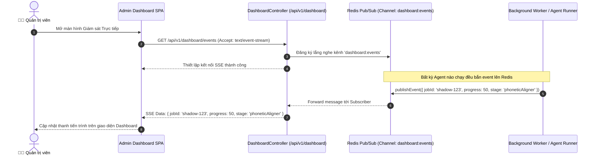

# Module Dashboard & Observability — Business Specification

> **Tài liệu cha:** [Requirement Analysis Package](../../README.md)  
> **Mã Module:** `DASH` | **Tên miền nghiệp vụ:** Quản Trị & Khả Năng Quan Sát Toàn Diện (Dashboard & Observability)  
> **Tài liệu liên kết:** [API Contract](api-contract.md) | [Acceptance Criteria](acceptance-criteria.md)  
> **Tác giả:** Anh Tú — Giảng viên CNTT & Technical Writer

---

## 1. Mục Tiêu Nghiệp Vụ (Business Objective)

Khi vận hành một hệ thống Multi-Agent AI trong môi trường sản xuất, việc thiếu khả năng quan sát (*Observability Blind Spots*) có thể gây ra những hậu quả nghiêm trọng:
1. **Mù thông tin vận hành:** Không nắm được có bao nhiêu tác vụ Agent đang chạy, tiến độ từng Node ra sao cho đến khi người dùng báo lỗi.
2. **Thất thoát chi phí LLM Token:** Không thể bóc tách xem Node nào đang ngốn nhiều Token nhất hoặc Node nào bị lặp lại nhiều lần.
3. **Bất tiện khi tinh chỉnh Prompt:** Mỗi lần muốn thử nghiệm thay đổi System Prompt hoặc chuyển đổi model AI (ví dụ từ Gemini Flash sang Gemini Pro) lại phải commit code và deploy lại toàn bộ dự án.

**Dashboard & Observability Module** ra đời nhằm cung cấp cho Quản trị viên và Kỹ sư AI:
* Màn hình Live Stream theo dõi toàn bộ sự kiện của các tác vụ theo thời gian thực (thông qua Redis Pub/Sub Fan-out).
* Thống kê chi tiết về độ trễ trung bình, tỷ lệ thành công/thất bại, và lượng token tiêu thụ theo thời gian.
* Bảng điều khiển cấu hình động (*Hot Configuration*) cho phép ghi đè System Prompt, Model và Temperature ở cấp độ từng Node mà không cần khởi động lại server.

---

## 2. Yêu Cầu Chức Năng (Functional Requirements)

| Mã FR | Tên tính năng | Tác nhân | Tiền điều kiện | Hậu điều kiện | API Endpoint tương ứng | Tiêu chí chấp nhận (AC) |
|---|---|---|---|---|---|---|
| **FR-DASH-01** | Lắng nghe luồng sự kiện Real-time | Quản trị viên | Đăng nhập Admin UI | Nhận SSE stream toàn bộ Job qua Redis Pub/Sub | [`GET /api/v1/dashboard/events`](api-contract.md#11-get-apiv1dashboardevents) | [`AC-DASH-01`](acceptance-criteria.md#ac-dash-01) |
| **FR-DASH-02** | Xem số liệu thống kê hệ thống (Metrics) | Quản trị viên | Có quyền truy cập | Trả về tổng số job, tỉ lệ thành công, token trung bình | [`GET /api/v1/dashboard/metrics`](api-contract.md#12-get-apiv1dashboardmetrics) | [`AC-DASH-02`](acceptance-criteria.md#ac-dash-02) |
| **FR-DASH-03** | Tra cứu phân trang nhật ký chạy Agent | Quản trị viên | Tham số page/limit | Trả về danh sách log chi tiết và token usage | [`GET /api/v1/dashboard/logs`](api-contract.md#13-get-apiv1dashboardlogs) | [`AC-DASH-03`](acceptance-criteria.md#ac-dash-03) |
| **FR-DASH-04** | Xem và cập nhật cấu hình Agent động | Quản trị viên | `agentId` hợp lệ | Cập nhật cấu hình vào CSDL `agent_configs` | [`GET / PUT /api/v1/dashboard/configs/:agentId`](api-contract.md#14-get-put-apiv1dashboardconfigsagentid) | [`AC-DASH-04`](acceptance-criteria.md#ac-dash-04) |

---

## 3. Câu Chuyện Người Dùng (User Stories)

### US-DASH-01: Giám sát Trực quan Luồng Chạy Agent theo Thời gian thực
- **Mã:** `US-DASH-01`
- **Tác nhân:** Quản trị viên hệ thống / AI Engineer
- **Mức độ ưu tiên:** Bắt buộc (Must-have)
- **Ánh xạ FR:** [`FR-DASH-01`](#2-yeu-cau-chuc-nang), [`FR-DASH-02`](#2-yeu-cau-chuc-nang)
- **Ánh xạ API:** [`GET /api/v1/dashboard/events`](api-contract.md#11-get-apiv1dashboardevents)
- **Ánh xạ AC:** [`AC-DASH-01`](acceptance-criteria.md#ac-dash-01)

**Lời tuyên bố câu chuyện:**
> **Là một** quản trị viên hệ thống,  
> **Tôi muốn** mở màn hình Admin Dashboard và thấy ngay các thẻ Job đang chạy với các bước cập nhật liên tục,  
> **Để** tôi phát hiện sớm các điểm nghẽn độ trễ hoặc lỗi phát sinh trong thời gian thực.

#### Sơ Đồ Trình Tự (Sequence Diagram)

---

*Made by Anh Tu - Share to be share*
