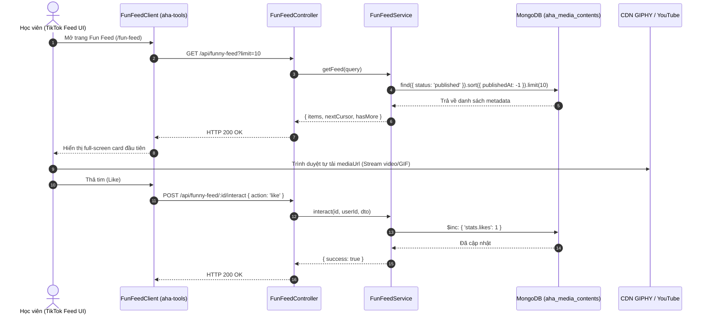
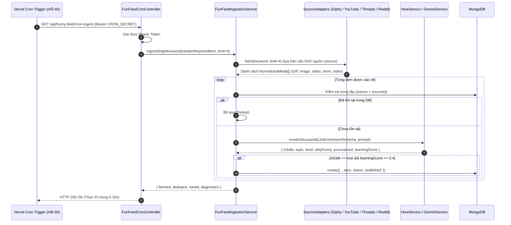

# Module Fun Feed — Business Specification

> **Tài liệu cha:** [Requirement Analysis Package](../../README.md)  
> **Mã Module:** `FEED` | **Tên miền nghiệp vụ:** Bảng Tin Hài Hước Học Tiếng Anh (TikTok-style English Fun Feed)  
> **Tài liệu liên kết:** [API Contract](api-contract.md) | [Acceptance Criteria](acceptance-criteria.md) | [Hợp đồng tích hợp Frontend](../../../docs/contracts/fun-feed-api-contract.md)  
> **Tác giả:** Anh Tú — Giảng viên CNTT & Technical Writer

---

## 1. Mục Tiêu Nghiệp Vụ (Business Objective)

### 1.1. Phân Tích Nguyên Nhân Gốc Rễ (Root Cause Analysis)
Việc học tiếng Anh truyền thống của người học thường đối mặt với các rào cản tâm lý và hành vi sau:
1. **Áp lực nhận thức và Hội chứng "sợ học" (Cognitive Overload & Study Anxiety):** Người học thường cảm thấy việc học từ vựng và ngữ pháp là một công việc nặng nề, đòi hỏi sự tập trung cao độ và môi trường nghiêm túc. Điều này dẫn đến sự trì hoãn và giảm sút thời gian tiếp xúc tự nhiên với ngôn ngữ (*Language Exposure*).
2. **Sự bùng nổ của hành vi tiêu thụ nội dung dạng ngắn (Short-form Dopamine Micro-sessions):** Người dùng hiện đại có thói quen lướt TikTok, Facebook Reels và YouTube Shorts trong các khoảng thời gian rảnh rỗi (vi-thời gian từ 1-3 phút). Các ứng dụng học tiếng Anh truyền thống thất bại trong việc chiếm lĩnh thói quen này vì giao diện mang tính chất "làm bài tập" thay vì "giải trí".

### 1.2. Giải Pháp Kiến Trúc (Architectural Solution)
Nhằm mang lại trải nghiệm học tập tự nhiên (Edutainment), tính năng **Fun Feed** biến việc học tiếng Anh thành trải nghiệm lướt meme vui nhộn tương tự TikTok:
* **Học qua Đa Phương Tiện Thực Tế (Contextual Multi-Source Learning):** Mỗi meme hoặc video ngắn từ **GIPHY, YouTube Shorts, Threads (Meta) và Reddit** (và kế thừa TikTok ở Phase 2) đều được AI (Gemini / Hive) "giải phẫu" để cung cấp: *tại sao nó buồn cười* (`whyFunny`) và *bài học rút ra* (`youLearned`).
* **Kiến Trúc Tách Rời Hoàn Toàn (Decoupled Ingestion & Serving):** 
  - Toàn bộ khâu cào dữ liệu, lọc an toàn và làm giàu nội dung được đẩy về hậu trường thông qua **Vercel Cron Trigger dạng Light-Batch**, vận hành độc lập theo từng `SourceAdapter` cắm rút (Plug-and-play).
  - Phía Client (`aha-tools`) chỉ đọc siêu dữ liệu (Metadata) siêu nhẹ qua **Cursor Pagination** từ MongoDB, còn băng thông media (video/ảnh/GIF) được truyền trực tiếp từ CDN của nền tảng nguồn (GIPHY, YouTube, i.redd.it, Meta CDN).
* **Cơ Chế Kiểm Duyệt Tự Động & Tự Ẩn (Community Moderation):** Nội dung bắt buộc đạt chuẩn an toàn, qua màng lọc của LLM (`isSafe === true` và `learningScore >= 0.4`) và tự động bị ẩn (`hidden`) khi nhận $\ge 3$ lượt báo cáo vi phạm từ cộng đồng.

---

## 2. Yêu Cầu Chức Năng (Functional Requirements)

| Mã FR | Tên tính năng | Tác nhân | Tiền điều kiện | Hậu điều kiện | API Endpoint tương ứng | Tiêu chí chấp nhận (AC) |
|---|---|---|---|---|---|---|
| **FR-FEED-01** | Lướt bảng tin phân trang con trỏ | Học viên / Client PWA | Ứng dụng đã khởi tạo | Trả về 10 media items mới nhất (hỗ trợ GIF, short video, meme image) kèm `nextCursor` | [`GET /api/funny-feed`](api-contract.md#11-get-apifunny-feed) | [`AC-FEED-01`](acceptance-criteria.md#ac-feed-01) |
| **FR-FEED-02** | Ghi nhận tương tác người dùng | Học viên / Client PWA | `contentId` hợp lệ | Cập nhật số liệu like/save/report, tự ẩn nếu $\ge 3$ reports | [`POST /api/funny-feed/:id/interact`](api-contract.md#12-post-apifunny-feedidinteract) | [`AC-FEED-02`](acceptance-criteria.md#ac-feed-02) |
| **FR-FEED-03** | Kích hoạt cào và làm giàu dữ liệu định kỳ đa nguồn | Vercel Cron Scheduler | Header chứa `CRON_SECRET` hợp lệ | Bốc ngẫu nhiên từ khóa/subreddit, cào từ GIPHY/YouTube/Threads/Reddit, enrich bằng LLM và lưu DB | [`GET /api/funny-feed/cron-ingest`](api-contract.md#13-get-apifunny-feedcron-ingest) | [`AC-FEED-03`](acceptance-criteria.md#ac-feed-03) |
| **FR-FEED-04** | Trích xuất meme hài hước qua Agent Tool | Aha Mind Agent | Learner yêu cầu gợi ý meme/video | Trả về 1-3 items hài hước đã được xuất bản | Tool `get_funny_english` | [`AC-FEED-04`](acceptance-criteria.md#ac-feed-04) |

---

## 3. Câu Chuyện Người Dùng (User Stories)

### US-FEED-01: Lướt xem meme tiếng Anh giải trí dạng dọc (Vertical Feed)
- **Mã:** `US-FEED-01`
- **Tác nhân:** Học viên (Learner)
- **Mức độ ưu tiên:** Bắt buộc (Must-have)
- **Ánh xạ FR:** [`FR-FEED-01`](#2-yeu-cau-chuc-nang), [`FR-FEED-02`](#2-yeu-cau-chuc-nang)
- **Ánh xạ API:** [`GET /api/funny-feed`](api-contract.md#11-get-apifunny-feed), [`POST /api/funny-feed/:id/interact`](api-contract.md#12-post-apifunny-feedidinteract)

**Lời tuyên bố câu chuyện (User Story Statement):**
> **Là một** người học tiếng Anh bận rộn muốn giải tỏa căng thẳng,  
> **Tôi muốn** mở ứng dụng và vuốt dọc màn hình để xem liên tục các meme/GIF và video ngắn vui nhộn về ngữ pháp, phát âm và thành ngữ,  
> **Để** tôi vừa giải trí vừa vô thức học được các cấu trúc ngôn ngữ thực tế mà không cảm thấy áp lực bài tập.

#### Sơ Đồ Trình Tự — Người Dùng Lướt Feed và Tương Tác (Sequence Diagram Flow 1)

---

### US-FEED-02: Tự động thu thập và kiểm duyệt nội dung hậu trường
- **Mã:** `US-FEED-02`
- **Tác nhân:** Vercel Cron Scheduler (Hệ thống)
- **Mức độ ưu tiên:** Bắt buộc (Must-have)
- **Ánh xạ FR:** [`FR-FEED-03`](#2-yeu-cau-chuc-nang)
- **Ánh xạ API:** [`GET /api/funny-feed/cron-ingest`](api-contract.md#13-get-apifunny-feedcron-ingest)

#### Sơ Đồ Trình Tự — Thu Thập & Làm Giàu Nội Dung Đa Nguồn Qua Cron (Sequence Diagram Flow 2)

---

*Made by Anh Tu - Share to be share*
