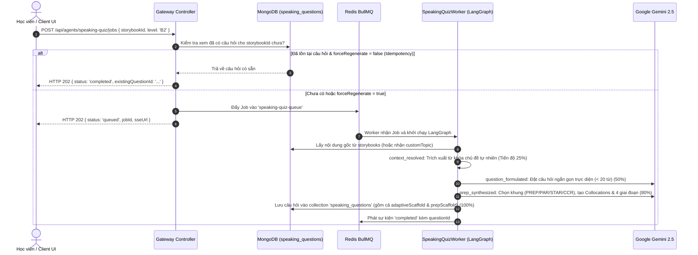

# Module Speaking Quiz — Business Specification

> **Tài liệu cha:** [Requirement Analysis Package](../../README.md)  
> **Mã Module:** `QUIZ` | **Tên miền nghiệp vụ:** Tác nhân Luyện Nói Phản Xạ & Giàn Giáo PREP (Speaking Quiz)  
> **Tài liệu liên kết:** [API Contract](api-contract.md) | [Acceptance Criteria](acceptance-criteria.md)  
> **Tác giả:** Anh Tú — Giảng viên CNTT & Technical Writer

---

## 1. Mục Tiêu Nghiệp Vụ (Business Objective)

Nhiều người học tiếng Anh sau khi luyện nghe hoặc luyện Shadowing vẫn gặp trở ngại lớn khi phải **tự mình diễn đạt ý kiến độc lập**:
1. **Bế tắc ý tưởng:** Không biết bắt đầu câu trả lời từ đâu khi gặp một câu hỏi mở.
2. **Thiếu tính logic và thuyết phục:** Câu trả lời thường ngắn cụt lủn (1-2 câu), thiếu dẫn chứng (*Example*) hoặc thiếu giải thích nguyên nhân sâu xa (*Reason*).
3. **Mất tự tin khi tranh biện:** Không có mẫu câu dẫn đường (*Signposts*) chuẩn mực quốc tế.

**Speaking Quiz Agent** giải quyết triệt để vấn đề này bằng cách:
* Phân tích nội dung cốt lõi của bài đọc Storybook hoặc chủ đề tự do để đặt ra câu hỏi thảo luận sâu sắc, ngắn gọn trực diện (< 20 từ).
* Tự động kiến thiết **Giàn giáo Tư duy Thích ứng (Adaptive Frameworks)** phù hợp với từng dạng câu hỏi: **PREP** (Quan điểm/Tranh biện), **PAR** (Lời khuyên/Giải pháp), **STAR** (Kể chuyện/Kinh nghiệm), **CCR** (Thương lượng/Cân nhắc đa chiều) — duy trì cầu nối tương thích ngược 100% với PREP legacy.
* Cung cấp **Bộ công cụ cụm từ bản xứ (Topic Collocations & Idioms Toolkit)** với 2–4 cụm từ bản xứ tự nhiên kèm nghĩa tiếng Việt, được lồng ghép hài hòa vào câu mẫu.
* Thích ứng linh hoạt theo 3 cấp độ CEFR: **B1** (Căn bản, từ vựng quen thuộc), **B2** (Mở rộng, từ vựng phong phú), **C1** (Chuyên sâu, cấu trúc câu phức tạp).

---

## 2. Yêu Cầu Chức Năng (Functional Requirements)

| Mã FR | Tên tính năng | Tác nhân | Tiền điều kiện | Hậu điều kiện | API Endpoint tương ứng | Tiêu chí chấp nhận (AC) |
|---|---|---|---|---|---|---|
| **FR-QUIZ-01** | Tạo câu hỏi phản xạ từ Storybook hoặc Custom Topic | Học viên / Tác giả | `storybookId` hoặc `customTopic` hợp lệ | Khởi tạo Job sinh câu hỏi hoặc trả câu hỏi có sẵn | [`POST /api/agents/speaking-quiz/jobs`](api-contract.md#11-post-apiagentsspeaking-quizjobs) | [`AC-QUIZ-01`](acceptance-criteria.md#ac-quiz-01), [`AC-QUIZ-03`](acceptance-criteria.md#ac-quiz-03) |
| **FR-QUIZ-02** | Xây dựng giàn giáo tư duy thích ứng & Collocations | Hệ thống Worker | LLM Gemini suy luận | Tự động chọn khung (PREP/PAR/STAR/CCR), tạo 2-4 collocations và ánh xạ về PREP legacy | [`POST /api/agents/speaking-quiz/jobs`](api-contract.md#11-post-apiagentsspeaking-quizjobs) | [`AC-QUIZ-01`](acceptance-criteria.md#ac-quiz-01) |
| **FR-QUIZ-03** | Tái sử dụng câu hỏi (Idempotency) | Học viên / Tác giả | `forceRegenerate === false` | Trả về câu hỏi có sẵn trong $< 50\text{ms}$, tiết kiệm 100% Token | [`POST /api/agents/speaking-quiz/jobs`](api-contract.md#11-post-apiagentsspeaking-quizjobs) | [`AC-QUIZ-03`](acceptance-criteria.md#ac-quiz-03) |
| **FR-QUIZ-04** | Theo dõi tiến độ sinh câu hỏi qua SSE | Học viên / Client | `jobId` hợp lệ | Nhận luồng SSE với % tiến độ và giai đoạn xử lý | [`GET /api/agents/speaking-quiz/jobs/:jobId/progress`](api-contract.md#12-get-apiagentsspeaking-quizjobsjobidprogress) | [`AC-QUIZ-04`](acceptance-criteria.md#ac-quiz-04) |
| **FR-QUIZ-05** | Truy vấn chi tiết câu hỏi theo ID | Học viên / Client | `id` câu hỏi tồn tại | Trả về câu hỏi, collocations, giàn giáo thích ứng và giàn giáo PREP tương thích ngược | [`GET /api/agents/speaking-quiz/questions/:id`](api-contract.md#13-get-apiagentsspeaking-quizquestionsid) | [`AC-QUIZ-05`](acceptance-criteria.md#ac-quiz-05) |
| **FR-QUIZ-06** | Dòng chảy từ vựng hữu cơ (Organic Lexical Flow) | Hệ thống Worker | Storybook hoặc Custom Topic | Trích xuất từ vựng trọng tâm tự nhiên, không gò ép từ vựng FSRS ngẫu nhiên; hỗ trợ lưu collocations vào `vocab_cards` | [`POST /api/agents/speaking-quiz/jobs`](api-contract.md#11-post-apiagentsspeaking-quizjobs) | [`AC-QUIZ-06`](acceptance-criteria.md#ac-quiz-06) |

---

## 3. Câu Chuyện Người Dùng (User Stories)

### US-QUIZ-01: Sinh câu hỏi Speaking phản xạ kèm giàn giáo Thích ứng & Bộ Collocations
- **Mã:** `US-QUIZ-01`
- **Tác nhân:** Học viên / Giáo viên
- **Mức độ ưu tiên:** Bắt buộc (Must-have)
- **Ánh xạ FR:** [`FR-QUIZ-01`](#2-yeu-cau-chuc-nang), [`FR-QUIZ-02`](#2-yeu-cau-chuc-nang), [`FR-QUIZ-03`](#2-yeu-cau-chuc-nang), [`FR-QUIZ-06`](#2-yeu-cau-chuc-nang)
- **Ánh xạ API:** [`POST /api/agents/speaking-quiz/jobs`](api-contract.md#11-post-apiagentsspeaking-quizjobs)
- **Ánh xạ AC:** [`AC-QUIZ-01`](acceptance-criteria.md#ac-quiz-01), [`AC-QUIZ-03`](acceptance-criteria.md#ac-quiz-03), [`AC-QUIZ-06`](acceptance-criteria.md#ac-quiz-06)

**Lời tuyên bố câu chuyện (User Story Statement):**
> **Là một** học viên vừa hoàn thành bài học Shadowing hoặc đang luyện nói phản xạ,  
> **Tôi muốn** hệ thống tạo ra một câu hỏi luyện nói tình huống tự nhiên, áp dụng khung giàn giáo phù hợp nhất (PREP, PAR, STAR, hoặc CCR) kèm các cụm từ bản xứ (collocations) theo chủ đề,  
> **Để** tôi có thể luyện tập phát biểu bài bản, thoát nghĩa tự nhiên, làm giàu vốn cụm từ và tự tin nói mà không bị bí ý.

#### Sơ Đồ Trình Tự (Sequence Diagram)

---

*Made by Anh Tu - Share to be share*

