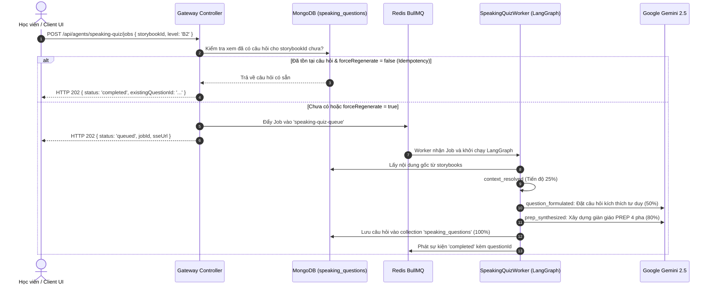

# Module Speaking Quiz — Business Specification

> **Tài liệu cha:** [Requirement Analysis Package](../../README.md)  
> **Mã Module:** `QUIZ` | **Tên miền nghiệp vụ:** Tác nhân Luyện Nói Phản Xạ & Giàn Giáo PREP (Speaking Quiz)  
> **Tài liệu liên kết:** [API Contract](api-contract.md) | [Acceptance Criteria](acceptance-criteria.md)  
> **Tác giả:** Anh Tú — Giảng viên CNTT & Technical Writer

---

## 1. Mục Tiêu Nghiệp Vụ (Business Objective)

Nhiều người học tiếng Anh sau khi luyện nghe hoặc luyện Shadowing vẫn gặp trở ngại lớn khi phải **tự mình diễn đạt ý kiến độc lập**:
1. **Bế tắc ý tưởng:** Không biết bắt đầu câu trả lời từ đâu khi gặp một câu hỏi mở.
2. **Thiếu tính logic và thuyết phục:** Câu trả lời thường ngắn cụt lủn (1-2 câu), thiếu dẫn chứng (*Example*) hoặc thiếu giải thích nguyên nhân sâu xa (*Reason*).
3. **Mất tự tin khi tranh biện:** Không có mẫu câu dẫn đường (*Signposts*) chuẩn mực quốc tế.

**Speaking Quiz Agent** giải quyết triệt để vấn đề này bằng cách:
* Phân tích nội dung cốt lõi của bài đọc Storybook để đặt ra câu hỏi thảo luận sâu sắc, kích thích tư duy phản biện (*Critical Thinking*).
* Tự động kiến thiết **Giàn giáo Tư duy 4 giai đoạn PREP** (Point $\rightarrow$ Reason $\rightarrow$ Example $\rightarrow$ Conclusion) kèm gợi ý và các từ nối học thuật (*Signpost words*).
* Thích ứng linh hoạt theo 3 cấp độ CEFR: **B1** (Căn bản, từ vựng quen thuộc), **B2** (Mở rộng, từ vựng phong phú), **C1** (Chuyên sâu, cấu trúc câu phức tạp).

---

## 2. Yêu Cầu Chức Năng (Functional Requirements)

| Mã FR | Tên tính năng | Tác nhân | Tiền điều kiện | Hậu điều kiện | API Endpoint tương ứng | Tiêu chí chấp nhận (AC) |
|---|---|---|---|---|---|---|
| **FR-QUIZ-01** | Tạo câu hỏi phản xạ từ Storybook | Học viên / Tác giả | `storybookId` hợp lệ | Khởi tạo Job sinh câu hỏi hoặc trả câu hỏi có sẵn | [`POST /api/agents/speaking-quiz/jobs`](api-contract.md#11-post-apiagentsspeaking-quizjobs) | [`AC-QUIZ-01`](acceptance-criteria.md#ac-quiz-01), [`AC-QUIZ-03`](acceptance-criteria.md#ac-quiz-03) |
| **FR-QUIZ-02** | Xây dựng giàn giáo tư duy PREP | Hệ thống Worker | LLM Gemini suy luận | Đảm bảo đủ 4 giai đoạn Point, Reason, Example, Conclusion | [`POST /api/agents/speaking-quiz/jobs`](api-contract.md#11-post-apiagentsspeaking-quizjobs) | [`AC-QUIZ-01`](acceptance-criteria.md#ac-quiz-01) |
| **FR-QUIZ-03** | Tái sử dụng câu hỏi (Idempotency) | Học viên / Tác giả | `forceRegenerate === false` | Trả về câu hỏi có sẵn trong $< 50\text{ms}$, tiết kiệm 100% Token | [`POST /api/agents/speaking-quiz/jobs`](api-contract.md#11-post-apiagentsspeaking-quizjobs) | [`AC-QUIZ-03`](acceptance-criteria.md#ac-quiz-03) |
| **FR-QUIZ-04** | Theo dõi tiến độ sinh câu hỏi qua SSE | Học viên / Client | `jobId` hợp lệ | Nhận luồng SSE với % tiến độ và giai đoạn xử lý | [`GET /api/agents/speaking-quiz/jobs/:jobId/progress`](api-contract.md#12-get-apiagentsspeaking-quizjobsjobidprogress) | [`AC-QUIZ-04`](acceptance-criteria.md#ac-quiz-04) |
| **FR-QUIZ-05** | Truy vấn chi tiết câu hỏi theo ID | Học viên / Client | `id` câu hỏi tồn tại | Trả về câu hỏi, từ vựng trọng tâm và giàn giáo PREP hoàn chỉnh | [`GET /api/agents/speaking-quiz/questions/:id`](api-contract.md#13-get-apiagentsspeaking-quizquestionsid) | [`AC-QUIZ-05`](acceptance-criteria.md#ac-quiz-05) |

---

## 3. Câu Chuyện Người Dùng (User Stories)

### US-QUIZ-01: Sinh câu hỏi Speaking phản xạ kèm giàn giáo PREP
- **Mã:** `US-QUIZ-01`
- **Tác nhân:** Học viên / Giáo viên
- **Mức độ ưu tiên:** Bắt buộc (Must-have)
- **Ánh xạ FR:** [`FR-QUIZ-01`](#2-yeu-cau-chuc-nang), [`FR-QUIZ-02`](#2-yeu-cau-chuc-nang), [`FR-QUIZ-03`](#2-yeu-cau-chuc-nang)
- **Ánh xạ API:** [`POST /api/agents/speaking-quiz/jobs`](api-contract.md#11-post-apiagentsspeaking-quizjobs)
- **Ánh xạ AC:** [`AC-QUIZ-01`](acceptance-criteria.md#ac-quiz-01), [`AC-QUIZ-03`](acceptance-criteria.md#ac-quiz-03)

**Lời tuyên bố câu chuyện (User Story Statement):**
> **Là một** học viên vừa hoàn thành bài học Shadowing,  
> **Tôi muốn** hệ thống tạo ra một câu hỏi luyện nói tình huống bám sát chủ đề bài đọc,  
> **Để** tôi có thể luyện tập phát biểu theo cấu trúc PREP bài bản, tự tin phản xạ mà không bị bí từ hay bí ý.

#### Sơ Đồ Trình Tự (Sequence Diagram)

---

*Made by Anh Tu - Share to be share*
