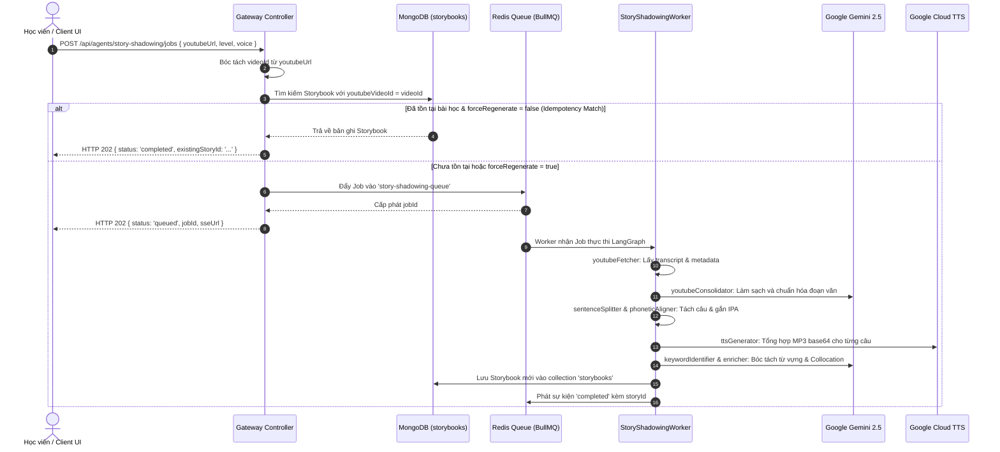
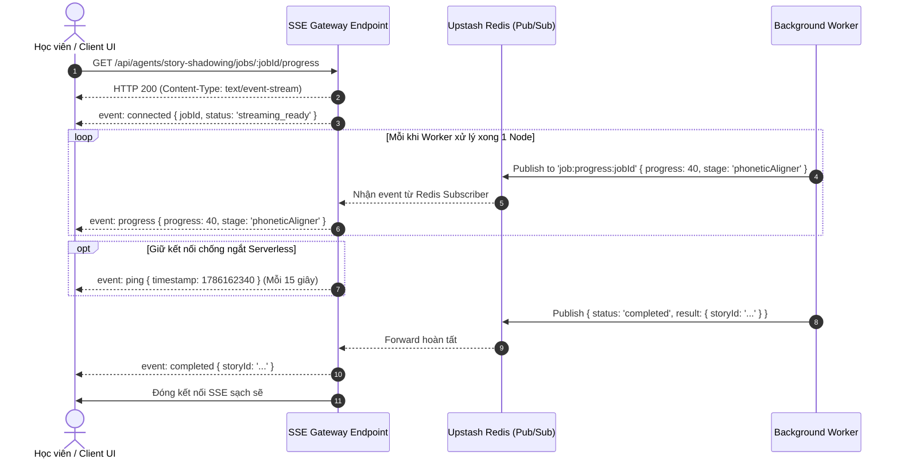

# Module Story Shadowing — Business Specification

> **Tài liệu cha:** [Requirement Analysis Package](../../README.md)  
> **Mã Module:** `SHADOW` | **Tên miền nghiệp vụ:** Tác nhân Luyện Nói Phản Xạ qua Câu Chuyện (Speech Shadowing)  
> **Tài liệu liên kết:** [API Contract](api-contract.md) | [Acceptance Criteria](acceptance-criteria.md)  
> **Tác giả:** Anh Tú — Giảng viên CNTT & Technical Writer

---

## 1. Mục Tiêu Nghiệp Vụ (Business Objective)

Phương pháp **Speech Shadowing (Nói bóng)** là một trong những kỹ thuật hiệu quả nhất giúp người học tiếng Anh làm chủ ngữ điệu, trọng âm và phản xạ nối âm tự nhiên. Tuy nhiên, người học thường gặp 3 rào cản lớn:
1. Thiếu tài liệu chuẩn có phụ đề khớp chính xác từng từ với phiên âm IPA quốc tế.
2. Quá trình tự chuẩn bị một bài học (tìm video, bóc tách phụ đề, tra từ điển phiên âm, ghi âm phát âm chuẩn) mất từ 1 đến 2 giờ đồng hồ mỗi bài.
3. Không có sự liên kết giữa từ vựng trong ngữ cảnh và cách phát âm thực chiến.

**Story Shadowing Agent** giải quyết bài toán này bằng cách tự động hóa 100% quy trình trên thông qua chuỗi tác nhân đa nhiệm (Multi-Agent LangGraph Pipeline). Chỉ với một đường link YouTube hoặc một đoạn văn bản thô, hệ thống tạo ra một bài tập Shadowing đa phương tiện hoàn chỉnh trong chưa đầy 30 giây.

---

## 2. Yêu Cầu Chức Năng (Functional Requirements)

| Mã FR | Tên tính năng | Tác nhân | Tiền điều kiện | Hậu điều kiện | API Endpoint tương ứng | Tiêu chí chấp nhận (AC) |
|---|---|---|---|---|---|---|
| **FR-SHADOW-01** | Tạo bài học từ Video YouTube | Học viên / Tác giả | URL YouTube hợp lệ | Khởi tạo Job trong BullMQ hoặc trả ngay bài học có sẵn | [`POST /api/agents/story-shadowing/jobs`](api-contract.md#11-post-apiagentsstory-shadowingjobs) | [`AC-SHADOW-01`](acceptance-criteria.md#ac-shadow-01), [`AC-SHADOW-03`](acceptance-criteria.md#ac-shadow-03) |
| **FR-SHADOW-02** | Tạo bài học từ Văn bản thô | Học viên / Tác giả | Chuỗi văn bản độ dài 10 - 2000 từ | Khởi tạo Job xử lý phân tách câu và ngữ âm | [`POST /api/agents/story-shadowing/jobs`](api-contract.md#11-post-apiagentsstory-shadowingjobs) | [`AC-SHADOW-02`](acceptance-criteria.md#ac-shadow-02) |
| **FR-SHADOW-03** | Tái sử dụng bài học (Idempotency) | Học viên / Tác giả | `forceRegenerate === false` | Trả về bài học cũ trong $< 50\text{ms}$, không tiêu tốn Token | [`POST /api/agents/story-shadowing/jobs`](api-contract.md#11-post-apiagentsstory-shadowingjobs) | [`AC-SHADOW-03`](acceptance-criteria.md#ac-shadow-03) |
| **FR-SHADOW-04** | Theo dõi tiến độ thời gian thực qua SSE | Học viên / Client | `jobId` hợp lệ | Nhận luồng SSE với % tiến độ và tên stage từng Node | [`GET /api/agents/story-shadowing/jobs/:jobId/progress`](api-contract.md#12-get-apiagentsstory-shadowingjobsjobidprogress) | [`AC-SHADOW-04`](acceptance-criteria.md#ac-shadow-04) |
| **FR-SHADOW-05** | Truy vấn chi tiết bài học Storybook | Học viên / Client | `id` bài học tồn tại | Trả về JSON bài học chứa mảng câu, IPA, audio, từ vựng | [`GET /api/agents/story-shadowing/stories/:id`](api-contract.md#13-get-apiagentsstory-shadowingstoriesid) | [`AC-SHADOW-05`](acceptance-criteria.md#ac-shadow-05) |

---

## 3. Câu Chuyện Người Dùng (User Stories)

### US-SHADOW-01: Tạo bài tập Shadowing từ Video YouTube
- **Mã:** `US-SHADOW-01`
- **Tác nhân:** Học viên / Giáo viên
- **Mức độ ưu tiên:** Bắt buộc (Must-have)
- **Ánh xạ FR:** [`FR-SHADOW-01`](#2-yeu-cau-chuc-nang), [`FR-SHADOW-03`](#2-yeu-cau-chuc-nang)
- **Ánh xạ API:** [`POST /api/agents/story-shadowing/jobs`](api-contract.md#11-post-apiagentsstory-shadowingjobs)
- **Ánh xạ AC:** [`AC-SHADOW-01`](acceptance-criteria.md#ac-shadow-01), [`AC-SHADOW-03`](acceptance-criteria.md#ac-shadow-03)

**Lời tuyên bố câu chuyện (User Story Statement):**
> **Là một** học viên đang muốn luyện phát âm theo ngữ điệu video thực tế,  
> **Tôi muốn** dán một đường link video YouTube vào hệ thống và nhấn tạo bài học,  
> **Để** hệ thống tự động bóc tách phụ đề, chuẩn hóa phiên âm IPA từng từ, bóc tách từ vựng trọng tâm mà tôi không phải làm thủ công.

#### Sơ Đồ Trình Tự (Sequence Diagram)

---

### US-SHADOW-02: Theo dõi tiến độ thời gian thực qua Server-Sent Events (SSE)
- **Mã:** `US-SHADOW-02`
- **Tác nhân:** Học viên / Client UI
- **Mức độ ưu tiên:** Bắt buộc (Must-have)
- **Ánh xạ FR:** [`FR-SHADOW-04`](#2-yeu-cau-chuc-nang)
- **Ánh xạ API:** [`GET /api/agents/story-shadowing/jobs/:jobId/progress`](api-contract.md#12-get-apiagentsstory-shadowingjobsjobidprogress)
- **Ánh xạ AC:** [`AC-SHADOW-04`](acceptance-criteria.md#ac-shadow-04)

**Lời tuyên bố câu chuyện:**
> **Là một** học viên đang chờ bài học được tạo ra,  
> **Tôi muốn** nhìn thấy thanh tiến trình hiển thị rõ ràng từng giai đoạn (ví dụ: Đang lấy phụ đề 20% $\rightarrow$ Đang phân tích ngữ âm 50% $\rightarrow$ Đang tạo giọng đọc 80%),  
> **Để** tôi biết hệ thống đang hoạt động tích cực và nắm được thời gian bài tập sẵn sàng.

#### Sơ Đồ Trình Tự (Sequence Diagram)

---

*Made by Anh Tu - Share to be share*
