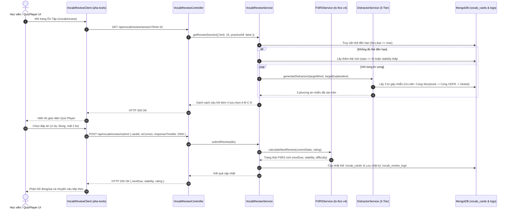
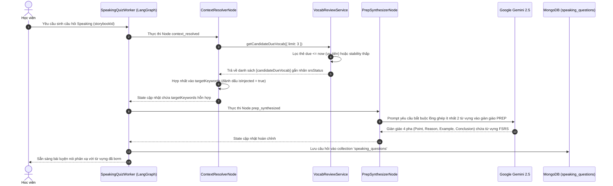

# Module Vocab Review — Business Specification

> **Tài liệu cha:** [Requirement Analysis Package](../../README.md)  
> **Mã Module:** `VOCAB` | **Tên miền nghiệp vụ:** Tác nhân Ôn Tập Từ Vựng Giãn Cách (Decoupled FSRS Engine)  
> **Tài liệu liên kết:** [API Contract](api-contract.md) | [Acceptance Criteria](acceptance-criteria.md)  
> **Tác giả:** Anh Tú — Giảng viên CNTT & Technical Writer

---

## 1. Mục Tiêu Nghiệp Vụ (Business Objective)

### 1.1. Phân Tích Nguyên Nhân Gốc Rễ (Root Cause Analysis)
Việc ghi nhớ từ vựng tiếng Anh của người học thường thất bại bởi hai nguyên nhân cốt lõi:
1. **Đường cong lãng quên (Ebbinghaus Forgetting Curve):** Não bộ con người quên đến 70% kiến thức mới sau 24-48 giờ nếu không có sự lặp lại ngắt quãng có chủ đích. Các hệ thống học truyền thống thường nhắc lại từ vựng theo chu kỳ cố định (Fixed intervals), dẫn đến việc từ dễ bị ôn tập quá nhiều gây nhàm chán, trong khi từ khó bị bỏ quên dẫn đến mất gốc.
2. **Sự đứt gãy giữa Trí nhớ Thụ động và Kích hoạt Chủ động (Passive-to-Active Memory Gap):** Người học có thể nhận diện được từ vựng khi làm bài tập trắc nghiệm (Passive Recognition), nhưng khi cần nói hoặc viết độc lập trong ngữ cảnh giao tiếp thực tế thì hoàn toàn bị "đóng băng" (Active Recall Deficit).

### 1.2. Giải Pháp Kiến Trúc (Architectural Solution)
Nhằm giải phóng ứng dụng Web Next.js (`aha-tools`) khỏi gánh nặng tính toán thuật toán phức tạp và tối ưu tốc độ render, toàn bộ động cơ ôn tập được chuyển giao về `aha-mind-agents` với các trụ cột sau:
* **Thuật toán FSRS v4 (Free Spaced Repetition Scheduler):** Ứng dụng mô hình toán học hiện đại nhất hiện nay (vượt trội hơn hẳn thuật toán SM-2 của Anki) dựa trên 3 thông số: Độ vững chắc (*Stability* $S$), Độ khó (*Difficulty* $D$), và Khoảng thời gian thu hồi (*Retrievability* $R$).
* **Động cơ Sinh Phương Án Nhiễu 3 Tầng (3-Tier Distractor Synthesis Pool):** Tự động tạo câu hỏi trắc nghiệm đa lựa chọn (Multiple Choice) hoặc điền từ vào chỗ trống (Cloze Test) với các phương án gây nhiễu ngữ nghĩa thông minh theo thứ tự ưu tiên: Cùng bài đọc $\rightarrow$ Cùng cấp độ CEFR $\rightarrow$ Ngân hàng từ vựng toàn cục.
* **Tích Hợp Tuần Hoàn với Tác Nhân Luyện Nói (SRS-to-Speaking Feedback Loop):** Tự động phát hiện các từ vựng đến hạn ôn tập (`due`) hoặc từ đang học có độ vững chắc thấp để "bơm" trực tiếp vào bài luyện nói Speaking Quiz, buộc người học phải kích hoạt từ vựng trong giàn giáo tư duy PREP.

---

## 2. Yêu Cầu Chức Năng (Functional Requirements)

| Mã FR | Tên tính năng | Tác nhân | Tiền điều kiện | Hậu điều kiện | API Endpoint tương ứng | Tiêu chí chấp nhận (AC) |
|---|---|---|---|---|---|---|
| **FR-VOCAB-01** | Khởi tạo phiên trắc nghiệm ôn tập | Học viên / Client PWA | Bộ sưu tập từ vựng đã lưu $\ge 1$ thẻ | Trả về danh sách câu hỏi trắc nghiệm / cloze kèm 4 lựa chọn A-B-C-D | [`GET /api/vocab/review/session`](api-contract.md#11-get-apivocabreviewsession) | [`AC-VOCAB-01`](acceptance-criteria.md#ac-vocab-01) |
| **FR-VOCAB-02** | Nộp kết quả và tính toán lịch FSRS | Học viên / Client PWA | `cardId` hợp lệ, trạng thái trả lời `isCorrect` | Cập nhật `stability`, `difficulty`, `due` và lưu nhật ký kiểm toán | [`POST /api/vocab/review/submit`](api-contract.md#12-post-apivocabreviewsubmit) | [`AC-VOCAB-02`](acceptance-criteria.md#ac-vocab-02) |
| **FR-VOCAB-03** | Thống kê số lượng thẻ đến hạn ôn tập | Học viên / Client PWA | Người dùng truy cập Dashboard / Header | Trả về số lượng thẻ `due`, `new`, `learning`, `mastered` | [`GET /api/vocab/review/due-count`](api-contract.md#13-get-apivocabreviewdue-count) | [`AC-VOCAB-03`](acceptance-criteria.md#ac-vocab-03) |
| **FR-VOCAB-04** | Trích xuất từ vựng ứng viên cho Speaking Quiz | Speaking Quiz Worker (Nội bộ) | Worker khởi chạy Node `context_resolved` | Trả về danh sách 1-4 từ vựng đến hạn có kèm gắn thẻ `srsStatus` | Dịch vụ nội bộ `VocabReviewService.getCandidateDueVocab` | [`AC-VOCAB-04`](acceptance-criteria.md#ac-vocab-04) |

---

## 3. Câu Chuyện Người Dùng (User Stories)

### US-VOCAB-01: Luyện tập trắc nghiệm từ vựng theo thuật toán FSRS
- **Mã:** `US-VOCAB-01`
- **Tác nhân:** Học viên (Learner)
- **Mức độ ưu tiên:** Bắt buộc (Must-have)
- **Ánh xạ FR:** [`FR-VOCAB-01`](#2-yeu-cau-chuc-nang), [`FR-VOCAB-02`](#2-yeu-cau-chuc-nang), [`FR-VOCAB-03`](#2-yeu-cau-chuc-nang)
- **Ánh xạ API:** [`GET /api/vocab/review/session`](api-contract.md#11-get-apivocabreviewsession), [`POST /api/vocab/review/submit`](api-contract.md#12-post-apivocabreviewsubmit)
- **Ánh xạ AC:** [`AC-VOCAB-01`](acceptance-criteria.md#ac-vocab-01), [`AC-VOCAB-02`](acceptance-criteria.md#ac-vocab-02), [`AC-VOCAB-03`](acceptance-criteria.md#ac-vocab-03)

**Lời tuyên bố câu chuyện (User Story Statement):**
> **Là một** học viên đang củng cố vốn từ tiếng Anh,  
> **Tôi muốn** hệ thống tự động lọc ra các từ vựng đến hạn ôn tập và hiển thị dưới dạng câu hỏi trắc nghiệm ngữ nghĩa và điền từ cloze test,  
> **Để** tôi có thể ôn tập chính xác các từ sắp bị quên theo thuật toán khoa học mà không phải ghi nhớ lịch ôn tập thủ công.

#### Sơ Đồ Trình Tự — Quy Trình Ôn Tập Trắc Nghiệm FSRS (Sequence Diagram Flow 1)

---

### US-VOCAB-02: Tự động kích hoạt từ vựng ôn tập trong Speaking Quiz
- **Mã:** `US-VOCAB-02`
- **Tác nhân:** Học viên / Hệ thống AI Tự động
- **Mức độ ưu tiên:** Bắt buộc (Must-have)
- **Ánh xạ FR:** [`FR-VOCAB-04`](#2-yeu-cau-chuc-nang)
- **Ánh xạ API:** Dịch vụ nội bộ `VocabReviewService.getCandidateDueVocab`
- **Ánh xạ AC:** [`AC-VOCAB-04`](acceptance-criteria.md#ac-vocab-04)

**Lời tuyên bố câu chuyện (User Story Statement):**
> **Là một** học viên đang rèn luyện phản xạ phát biểu bằng cấu trúc PREP,  
> **Tôi muốn** những từ vựng mà tôi đang sắp quên được tự động đưa vào làm từ khóa trọng tâm trong đề bài Speaking Quiz,  
> **Để** tôi được thử thách sử dụng từ vựng đó vào câu trả lời mẫu thực tế, chuyển hóa từ vựng từ trí nhớ thụ động thành năng lực sử dụng chủ động.

#### Sơ Đồ Trình Tự — Bơm Từ Vựng Đến Hạn Vào Speaking Quiz (Sequence Diagram Flow 2)

---

*Made by Anh Tu - Share to be share*
